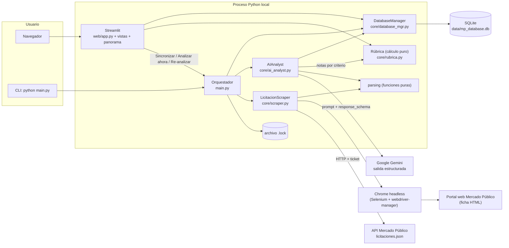
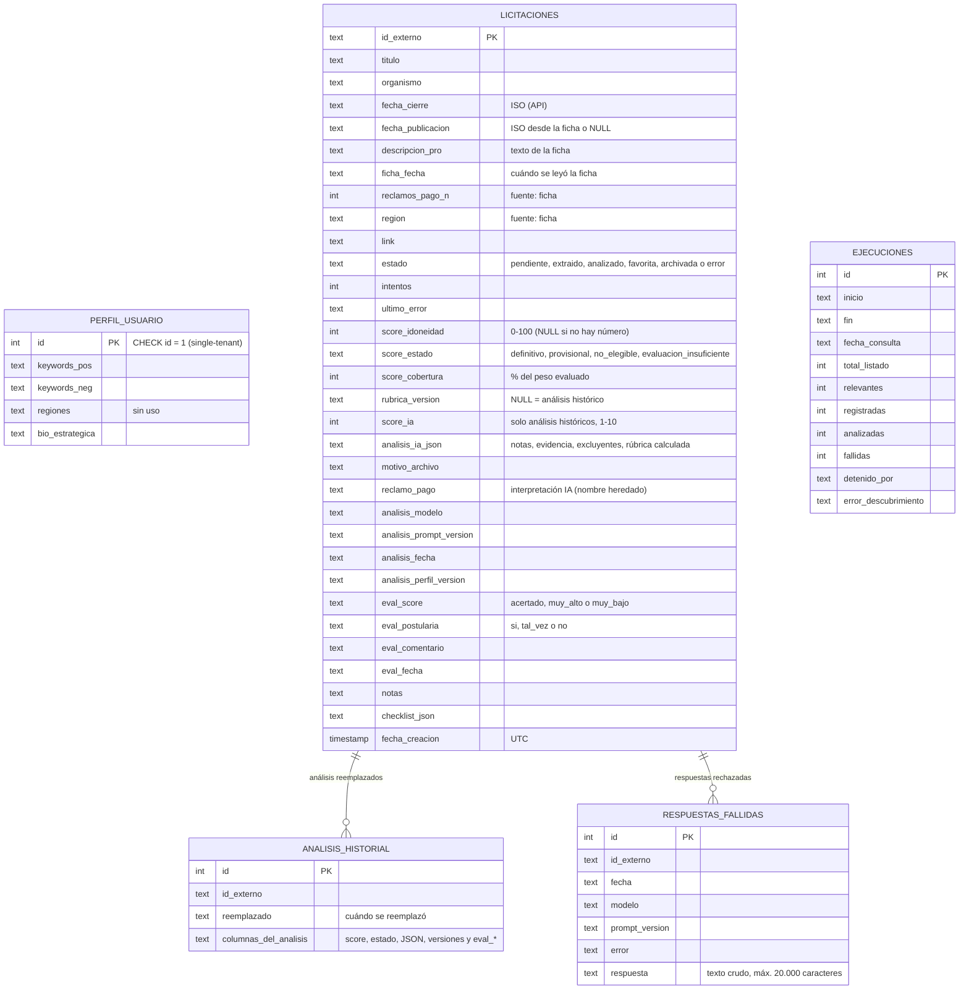
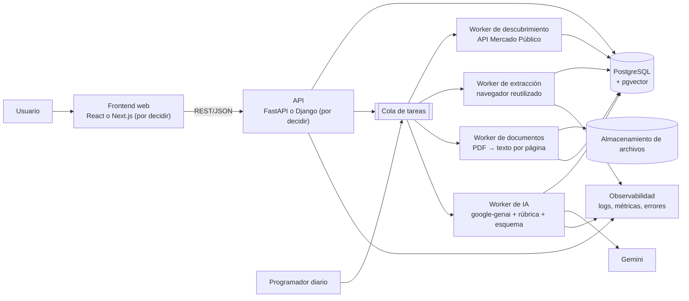

# LicitAI: dossier técnico del proyecto

> **Propósito.** Fuente de verdad para redactar el caso de estudio del portafolio, explicar decisiones de ingeniería y planificar una V2 Full Stack.
> **Estado documentado:** rama `main` (commit `ca854c1`), al **21/10/2026**. Incluye la rúbrica de idoneidad v1.1, la salida estructurada de Gemini, la gestión de la cola (prioridad por cierre, análisis a pedido) y la interfaz editorial clara.
> **Documento vivo:** las secciones marcadas con ⟳ (§4, §11, §20, §21) deben actualizarse a medida que se acumulen datos (ver §23.3).
> **Cómo leer las afirmaciones:**
> - **[Código]**: observado en el código fuente.
> - **[Test]**: cubierto por pruebas automatizadas que se ejecutaron (257/257 pasan).
> - **[Ejecución real]**: probado contra los servicios reales (API de Mercado Público, portal, Gemini).
> - **[Datos]**: consultado en las bases SQLite locales, en modo solo lectura.
> - **[Historial]**: tomado de git o de documentos versionados.
> - **[Simulado]**: generado a propósito para probar el flujo; **no** es evidencia de usuarios reales (ver §23.2).
> - **[Inferencia]**: deducción razonable, no confirmada.
> - **[Propuesta]**: no existe en el sistema actual.

---

## 1. Resumen ejecutivo

LicitAI es un **prototipo de radar de licitaciones públicas chilenas** (Mercado Público) pensado para el dueño de una pyme proveedora, que no tiene tiempo de revisar el portal a diario. Funciona en cuatro pasos:
1. Descubre las licitaciones publicadas en el día mediante la API oficial.
2. Filtra las relevantes por palabras clave del perfil de negocio.
3. Extrae con Selenium el texto completo de cada ficha.
4. Pide a Google Gemini que evalúe la licitación con una **rúbrica de idoneidad** de cinco criterios. Gemini entrega una nota de 0 a 5 por criterio con su evidencia, y **Python calcula el score de 0 a 100 y su estado** (definitivo, provisional, no elegible o evaluación incompleta).

Los resultados se gestionan en un dashboard Streamlit con estética editorial: oportunidades, favoritas, archivo, cola en proceso, panorama analítico y perfil **[Código]**.

Lo que distingue al prototipo no es la cantidad de funciones, sino el **rigor con que trata a la IA y a los datos**:
- **El total no lo decide el LLM.** El modelo da notas con evidencia; el cálculo, la cobertura y las reglas de exclusión viven en un módulo puro, versionado y probado (`core/rubrica.py`).
- **La incertidumbre se muestra, no se esconde.** La falta de datos no se confunde con compatibilidad: un score provisional se marca como tal, con su cobertura; un requisito excluyente confirmado deja la licitación como «no elegible» sin importar el resto.
- **Salida estructurada y validada.** Gemini responde con un esquema fijo. La respuesta se valida antes de guardarse, y las rechazadas se registran para diagnóstico.
- **Los datos verificables vienen de la fuente**, no de la IA: fecha, organismo y reclamos de pago se leen de la ficha con expresiones regulares.
- **Trazabilidad e historial.** Cada análisis registra modelo, versión del prompt, versión de la rúbrica y versión del perfil. Un re-análisis nunca borra el anterior, que queda en un historial junto con su evaluación humana.
- **Cola resiliente:** prioridad por fecha de cierre, reintentos acotados, análisis a pedido y bloqueo contra ejecuciones simultáneas.

Hay 257 pruebas automatizadas deterministas **[Test]**.

**Lo que no es:**
- No es un producto en producción, no tiene usuarios externos y no está desplegado.
- La precisión del score **no está medida con usuarios reales**. Hay 15 evaluaciones registradas, pero 14 son simuladas y solo 1 es del autor **[Datos]**.

---

## 2. Problema, usuario objetivo, contexto y propuesta de valor

| Aspecto | Descripción | Fuente |
|---|---|---|
| Problema | El portal publica más de mil licitaciones por día (entre 1.197 y 1.274 en el listado diario observado). Revisarlas a mano para encontrar las pocas pertinentes es lento, y las fichas son extensas (unos 10 k a 26 k caracteres de texto en las analizadas). El dueño de una pyme que busca en su tiempo personal pierde oportunidades por no alcanzar a revisar | `ejecuciones.total_listado` **[Datos]**; largo de fichas **[Datos]** |
| Usuario objetivo | Dueño de una pyme proveedora del Estado, con un perfil de negocio único (single-tenant), que quiere una **primera selección explicada** para decidir si vale la pena investigar más | Definición del autor; BR-01 «Single-tenant» en `.GEMINI.md` **[Historial]** |
| Contexto | Mercado Público (ChileCompra): la API pública entrega listados por fecha con pocos campos. El detalle útil (criterios, requisitos, reclamos de pago) está en la ficha web, y los requisitos completos suelen estar en las **bases en PDF**, que el prototipo no lee | Bitácora del 06/03/2026 («Gap de datos») **[Historial]**; `core/scraper.py` **[Código]**; 4 de 4 fichas revisadas remiten a bases o anexos **[Datos]** |
| Propuesta de valor | Revisar el portal por el usuario y dejarle los mejores prospectos con información para decidir: score de idoneidad con desglose y evidencia, requisitos por revisar, días al cierre y reclamos de pago del organismo | **[Código]**. *No hay medición de ahorro de tiempo ni de precisión.* |

**Usuario real:** no lo hay. El perfil es **ficticio**: una distribuidora de equipos, reactivos e insumos para laboratorio clínico y establecimientos de salud, con bodega en Santiago, despacho nacional y servicio técnico en tres regiones **[Datos]**. El rubro se eligió por su volumen de licitaciones, para reunir una muestra amplia.

Las palabras clave se ajustaron con datos reales. Sobre 2.756 títulos publicados en 6 días hábiles (14–21/10/2026), el perfil inicial coincidía con unas 5 licitaciones por día; el ampliado (laboratorio + insumos clínicos), con unas 17 por día, con calces variados, desde muy buenos hasta claramente fuera de rubro **[Ejecución real]**. En el caso de estudio debe presentarse como un perfil de demostración, no como un cliente.

---

## 3. Alcance actual y funcionalidades implementadas

### 3.1 Descubrimiento y registro
- **Fuente:** API `licitaciones.json?fecha=DDMMAAAA&ticket=…`, con timeout de 30 s y errores HTTP, de red y de JSON diferenciados. El ticket no aparece en los mensajes de error. `LicitacionScraper.descubrir_licitaciones_del_dia` **[Código][Test]**
- **Filtro:** estado 5 (Publicada), keywords positivas y negativas sin distinguir mayúsculas ni tildes, sin términos vacíos, y descarte de las ya cerradas. `filtrar_licitaciones_relevantes`, `parsing.coincide_keywords` **[Código][Test]**
- **Registro:** se registran **todas** las licitaciones nuevas relevantes; el límite por ejecución solo aplica al procesamiento. `main._ejecutar` **[Test]**

### 3.2 Cola de procesamiento
- **Origen:** la cola se arma desde la BD (estados `pendiente` y `extraido`), así que retoma automáticamente lo que no se procesó antes. `DatabaseManager.obtener_cola_procesamiento` **[Test]**
- **Orden:** primero la **fecha de cierre más próxima** (para no perder oportunidades esperando en la cola), luego la que falló menos veces y luego la más antigua. Las que no tienen fecha de cierre van al final **[Test]**.
- **Límite:** `LICITAI_MAX_PROCESAR` (5) **intentos** por ejecución.
- **Reintentos:** cada fallo suma un intento; con `LICITAI_MAX_INTENTOS` (3) intentos fallidos el registro pasa a `error`. Así, una licitación problemática ocupa a lo sumo 3 cupos en total **[Test]**.
- **Paradas que no consumen intentos:** cuota de Gemini agotada y Chrome que no arranca **[Test]**.
- **Análisis a pedido:** en «En proceso», el botón **«Analizar ahora»** procesa una licitación de inmediato, sin esperar la sincronización. Usa la misma función que la sincronización (`main.procesar_licitacion`) y el mismo bloqueo, así que ambos siguen las mismas reglas. `main.analizar_ahora` **[Test]**
- **Bloqueo** por archivo `<bd>.lock` contra ejecuciones simultáneas, con detección de bloqueos huérfanos después de 120 min. `main.bloqueo_pipeline` **[Test]**

### 3.3 Extracción
- **Navegación:** Selenium con Chrome headless navega a la ficha; espera a que el texto se estabilice y valida que realmente sea una ficha. `LicitacionScraper.extraer_detalle_licitacion`, `esperar_texto_estable`, `parsing.texto_ficha_valido` **[Código][Test parcial]**
- **Metadatos de la fuente:** título, organismo, fecha de publicación (ISO), fecha de cierre, número de reclamos por pago atrasado y región, extraídos con regex. `parsing.extraer_metadatos_ficha` **[Test]**. También se registra cuándo se leyó la ficha (`ficha_fecha`), que se muestra junto al dato de pagos.

### 3.4 Análisis de IA y score de idoneidad
- Gemini con **salida estructurada** (`response_schema`) y `temperature=0`; el texto de la ficha va truncado a 40 000 caracteres y delimitado como dato no confiable.
- Rúbrica de cinco criterios ponderados. El score y su estado los calcula Python (`core/rubrica.py`).
- Validación estricta antes de persistir; las respuestas rechazadas se guardan crudas en `respuestas_fallidas`.
- Trazabilidad (modelo, `PROMPT_VERSION`, `RUBRICA_VERSION`, versión del perfil) e historial de análisis reemplazados.
- Detalle en §11. **[Código][Test][Ejecución real]**

### 3.5 Interfaz (Streamlit, navegación superior)
| Página | Qué ofrece |
|---|---|
| **Oportunidades** | KPIs (el promedio usa solo scores definitivos), búsqueda y filtros (texto, score mínimo 0–100, región, orden, ocultar cerradas) y tarjetas con anillo de score por estado, chips de interpretación, cierre, región y reclamos. El desplegable muestra el veredicto, el **desglose por criterio con su evidencia**, los requisitos excluyentes, la información faltante, las advertencias, los hechos de la ficha frente a las inferencias de la IA, los riesgos comerciales y la evaluación humana. |
| **Favoritas** | El mismo análisis ampliado y «Preparación»: checklist y notas persistidas en SQLite. |
| **Archivo** | Licitaciones descartadas, con opción de restaurarlas. |
| **En proceso** | Cola en el orden en que se procesará, con «Analizar ahora» y, para las que fallaron, «Reintentar». Mensajes en lenguaje de usuario y detalles técnicos plegados. |
| **Panorama** | 5 visualizaciones en Altair (embudo, próximos cierres, score vs. reclamos, distribución por tramo de la rúbrica, calibración frente a la evaluación humana) y exportación JSON/CSV. |
| **Perfil** | Keywords y descripción de la empresa. Muestra el impacto de un cambio: re-analizar a pedido los análisis hechos con un perfil o una rúbrica anteriores (con confirmación) y descartar de la cola lo que ya no coincide. |

**Estética:** tema claro de estilo editorial. Lienzo color papel, tarjetas blancas, tinta grafito, un único acento azul tinta para lo interactivo y Newsreader (serif) para títulos, cifras y scores junto a Inter para el texto. Ambas fuentes van incluidas en el proyecto. Animaciones sobrias (entrada de tarjetas, llenado del anillo, elevación al pasar el mouse) que se desactivan con `prefers-reduced-motion`.

**Fuentes:** `web/app.py`, `web/vistas.py`, `web/panorama.py`, `web/estilos.py`, `.streamlit/config.toml` **[Código]**. La UI tiene tests con `streamlit.testing.AppTest` **[Test]**, y el render se verificó con capturas de un Chrome headless sobre una copia de la base real **[Ejecución real]**.

### 3.6 Herramientas de mantenimiento
- `python -m core.migrar_datos`: corrige bases antiguas a partir de las fichas ya guardadas. Por defecto solo simula; con `--aplicar` crea un respaldo antes **[Test]**.
- `python main.py --fecha DDMMAAAA --max N`: ejecuta el pipeline por línea de comandos **[Código]**.
- Logging opcional a archivo con `LICITAI_LOG_FILE` **[Test]**.
- `DatabaseManager.obtener_respuestas_fallidas()` y `obtener_historial(id)`: consulta de diagnóstico y de análisis anteriores **[Test]**.

---

## 4. Tabla de funcionalidades por nivel de verificación ⟳

| Funcionalidad | Estado | Evidencia |
|---|---|---|
| Descubrimiento por API + filtro de keywords, negativas y cierre | **Verificada** | `tests/test_pipeline.py`, `tests/test_parsing.py`; 5 ejecuciones reales registradas (listados de 1.197–1.274 licitaciones) |
| Registro completo y cola con límite por intentos | **Verificada** | `test_registra_todas_y_procesa_limite_luego_retoma`; ejecución real: 14 registradas, procesadas en lotes de 5 |
| Orden de la cola por cierre, luego intentos | **Verificada** | `test_cola_prioriza_el_cierre_mas_proximo`, `test_cola_prioriza_las_no_intentadas_sobre_los_reintentos` |
| Reintentos, estado `error` y «Reintentar» | **Verificada** | `test_fallos_repetidos_pasan_a_error_y_son_visibles`; observado en real (2 licitaciones llegaron a `error` por respuestas inválidas antes de la salida estructurada) |
| «Analizar ahora» desde En proceso | **Verificada (tests)** | 8 tests de `analizar_ahora` (pendiente, extraída, en error, fallo, cuota, cerrada, sincronización en curso, sin navegador) + test de UI. **No ejecutada aún contra servicios reales** |
| Extracción con Selenium (headless) | **Verificada (real) / parcial (tests)** | 17 fichas reales de 10–26 k caracteres. Los tests no cubren la navegación |
| Metadatos verificables desde la ficha | **Verificada** | `test_extraer_metadatos_ficha` |
| Rúbrica: cálculo, estados, rangos y redondeo | **Verificada** | `tests/test_rubrica.py` (29 tests) |
| Salida estructurada de Gemini | **Verificada (real, n pequeño)** | Sin esquema: 6 de 10 respuestas rechazadas en dos sincronizaciones reales. Con esquema: 8 de 8 válidas (3 de diagnóstico + 5 de una sincronización) |
| Tolerancia a claves alternativas (`capacity` → `capacidad`) | **Verificada (tests)** | 5 tests en `test_ai.py`, basados en una respuesta real |
| Registro de respuestas rechazadas | **Verificada (tests)** | 5 tests; tabla vacía en la BD real porque no hubo rechazos desde que existe |
| Historial de análisis al re-analizar | **Verificada** | `test_reanalisis_archiva_el_analisis_anterior_con_su_evaluacion`; 6 entradas reales **[Datos]** |
| Compatibilidad con análisis históricos (escala 1–10) | **Verificada** | Tests de migración; se mostraron como «rúbrica anterior» sin convertirse, y luego se re-analizaron a pedido |
| Estabilidad del score con `temperature=0` | **Parcial (n=1)** | Una licitación: 8/8/8 con la escala anterior. No repetido con la rúbrica |
| Bloqueo contra ejecuciones simultáneas | **Verificada** | `tests/test_infraestructura.py` |
| Favoritas, archivo, notas y checklist persistentes | **Verificada** | `test_notas_persisten` + verificación E2E en navegador |
| Evaluación humana del análisis | **Verificada (mecánica)** | `test_evaluacion_se_guarda`. 15 evaluaciones: **1 del autor y 14 simuladas** |
| Panorama: embudo, cierres, riesgo, histograma, calibración | **Verificada (render)** | `tests/test_panorama_exportar.py`; render real con datos. La calibración se dibuja, pero hoy usa casi solo evaluaciones simuladas |
| Exportación JSON/CSV (esquema v2) | **Verificada** | `test_json_separa_procedencia_y_excluye_privados`, `test_csv_plano` |
| Migración de BD antiguas | **Verificada** | `tests/test_migracion.py` |
| Cuota agotada de Gemini | **Verificada en real** | La cuota gratuita se agotó en una ejecución: el pipeline se detuvo sin consumir intentos |
| Ejecución programada (cron/Task Scheduler) | **No verificada** | El CLI existe; no se probó en un programador real |
| Despliegue (Streamlit Cloud u otro) | **No verificada** | No hay configuración de despliegue |
| Ticket inválido o límite diario de la API de MP | **No verificada en real** | Solo simulado |
| Lectura de bases PDF, multiusuario, autenticación | **Planificada / propuesta** | §17–19 |

---

## 5. Stack tecnológico y justificación con evidencia

| Componente | Versión fijada | Rol | Justificación documentada |
|---|---|---|---|
| Python | 3.11 (venv); `numpy` del árbol de dependencias exige ≥3.11 | Lenguaje | El README exige 3.11+ |
| Streamlit | 1.54.0 | UI | Usado desde el commit inicial (`7583721`) **[Historial]**; permite iterar rápido y probar páginas con `AppTest` |
| SQLite | estándar | Persistencia | Single-tenant y local **[Inferencia]**. El plan de estabilización prohibía migrar a PostgreSQL en esta fase **[Historial: `licitai-plan-estabilizacion.md`]** |
| Selenium + webdriver-manager | 4.40.0 / 4.0.2 | Extracción de la ficha | La API no entrega criterios ni requisitos, que sí están en la ficha web **[Historial: bitácora 06/03/2026]** |
| requests | 2.32.5 | Cliente de la API | — |
| google-generativeai | 0.8.6 | Cliente de Gemini (modelo `gemini-3-flash-preview`) | **SDK sin soporte de Google** (emite `FutureWarning`). Se decidió no migrarlo en el prototipo por su vida útil corta. Soporta `response_schema` como diccionario, lo que se verificó antes de adoptarlo **[Código][Ejecución real]** |
| Altair | 6.0.0 | Gráficos | Ya venía con Streamlit; se fijó porque se importa directamente |
| pytest | ≥8.0 (dev) | Pruebas | — |
| Inter y Newsreader (WOFF2, OFL) | — | Tipografía | Incluidas en `web/static/fonts/` con su licencia, para no depender de internet ni enviar datos a Google |

**Desarrollo asistido por IA [respuesta del autor + Historial].** El desarrollo usó asistentes de IA de forma explícita y como objetivo de aprendizaje: primero Gemini CLI (rastros en `.GEMINI.md`, `.gemini/` y las bitácoras «Gemini Prompts») y después Claude Code, con el que se hicieron la auditoría, la estabilización, la implementación de la rúbrica, la gestión de la cola y el rediseño. El método de trabajo fue: especificación escrita (p. ej. `licitai-scoring-rubrica-v1.md`), auditoría del código, plan con aprobación explícita del autor, implementación con pruebas, verificación contra los servicios reales y documentación. Para el caso de estudio conviene presentarlo con transparencia, poniendo el acento en ese criterio más que en la herramienta.

---

## 6. Arquitectura actual y responsabilidades

| Módulo | Responsabilidad | Funciones o clases clave |
|---|---|---|
| `core/config.py` | Variables de entorno, límites, escala histórica 1–10 (solo para mostrar análisis antiguos) y logging | `ruta_db`, `configurar_logging`, `MAX_PROCESAR`, `MAX_INTENTOS` |
| `core/rubrica.py` | **Rúbrica versionada:** criterios, pesos, escala, rangos, cálculo del score y su estado; lectura del resultado guardado (incluidos los históricos) | `RUBRICA_VERSION`, `CRITERIOS`, `calcular`, `resultado_guardado`, `texto_resultado`, `etiqueta_de` |
| `core/parsing.py` | Funciones puras: keywords, fechas, metadatos de la ficha, validación del JSON de la IA (con claves alternativas) y versión del perfil | `coincide_keywords`, `extraer_metadatos_ficha`, `validar_analisis`, `cargar_analisis_guardado`, `version_perfil` |
| `core/database_mgr.py` | DAO SQLite: esquema, migración aditiva, cola, fallos, análisis con historial, respuestas rechazadas, evaluación, ejecuciones y notas | `DatabaseManager`, `guardar_analisis_ia`, `obtener_cola_procesamiento`, `registrar_respuesta_fallida` |
| `core/scraper.py` | API de Mercado Público, filtro y extracción con Selenium | `LicitacionScraper`, `DriverNoDisponible`, `esperar_texto_estable` |
| `core/ai_analyst.py` | Prompt con la rúbrica, esquema de respuesta, llamada a Gemini, validación y persistencia | `AIAnalyst`, `esquema_respuesta`, `PROMPT_VERSION`, `AnalisisFallido`, `CuotaAgotada` |
| `core/exportar.py` | Exportación JSON/CSV independiente del esquema (v2) | `a_json`, `a_csv`, `registro_exportable` |
| `core/migrar_datos.py` | Corrección de BD antiguas y respaldos | `calcular_cambios`, `migrar`, `crear_respaldo` |
| `main.py` | Orquestador: bloqueo, descubrimiento, cola, procesamiento de una licitación, resumen; re-análisis en lote y análisis a pedido | `ejecutar_pipeline`, `procesar_licitacion`, `analizar_ahora`, `reanalizar_lote`, `bloqueo_pipeline` |
| `web/app.py` | Punto de entrada: configuración de página, CSS, logo, navegación superior y pie | — |
| `web/paginas/*.py` | Un archivo por página (necesario para probarlas con `AppTest.switch_page`) | — |
| `web/vistas.py` | Presentación: helpers puros, HTML escapado, tarjetas, desglose de la rúbrica, formularios, mensajes para el usuario y páginas | `html_tarjeta`, `chips_score`, `html_desglose`, `orden_cola`, `pagina_*` |
| `web/panorama.py` | Preparación de datos y gráficos Altair | `datos_histograma`, `datos_calibracion`, `datos_estados`, `grafico_*` |
| `web/estilos.py` | CSS del tema editorial claro y animaciones (depende de los `data-testid` de Streamlit 1.54) | `css`, `TOKENS` |

---

## 7. Diagrama de arquitectura actual

---

## 8. Flujo de procesamiento de una licitación

```mermaid
stateDiagram-v2
    [*] --> Listado: API por fecha
    Listado --> Descartada: no publicada, sin keyword positiva, con keyword negativa o ya cerrada
    Listado --> pendiente: nueva y relevante (INSERT OR IGNORE)
    Descartada --> [*]

    pendiente --> error: cerró antes de procesarse
    pendiente --> pendiente: fallo de extracción (quedan intentos)
    pendiente --> error: 3 fallos de extracción
    pendiente --> pendiente: Chrome no disponible (sin consumir intento, se detiene)
    pendiente --> extraido: ficha válida + metadatos de la fuente

    extraido --> extraido: respuesta de IA inválida o error de red (quedan intentos)
    extraido --> error: 3 fallos de IA
    extraido --> extraido: cuota agotada (sin consumir intento, se detiene)
    extraido --> analizado: JSON validado + rúbrica calculada + trazabilidad

    error --> pendiente: Reintentar (sin ficha)
    error --> extraido: Reintentar (con ficha)
    error --> analizado: Analizar ahora (reinicia intentos y procesa de inmediato)

    analizado --> favorita: Favorita
    analizado --> archivada: Archivar
    favorita --> analizado: Quitar
    archivada --> analizado: Restaurar
    analizado --> analizado: Re-analizar (el anterior pasa al historial; si falla, se conserva)
    favorita --> favorita: Re-analizar (conserva el estado)
```

Notas **[Código]**:
- El límite de 5 por ejecución cuenta **intentos**, no éxitos.
- La sincronización y «Analizar ahora» usan la misma función (`procesar_licitacion`), así que un análisis a pedido sigue las mismas reglas de fallos y reintentos.
- Un `extraido` no vuelve a pasar por Selenium. Cuando la extracción tiene éxito, se reinicia el contador de intentos.
- «Descartar de la cola» desde Perfil lleva los registros a `error` con un motivo.
- El **estado del score** (definitivo, provisional, no elegible, evaluación incompleta) es independiente del estado de gestión: una licitación «no elegible» sigue en Oportunidades hasta que el usuario la archive.

---

## 9. Modelo de datos, persistencia y ciclo de vida

- **Relaciones lógicas, sin claves foráneas declaradas.** El historial y las respuestas rechazadas se vinculan por `id_externo`. Ambas tablas son de solo inserción.
- **Migración de esquema aditiva e idempotente** (`_migrar_esquema`: `PRAGMA table_info` + `ALTER TABLE ADD COLUMN`; tablas nuevas con `CREATE TABLE IF NOT EXISTS`). Nunca borra ni reescribe datos **[Test]**.
- **Coexistencia de escalas sin mezclarlas:** los análisis nuevos guardan `score_idoneidad` (0–100) y dejan `score_ia` en `NULL`; los históricos conservan `score_ia` (1–10) y se muestran como «rúbrica anterior», nunca convertidos **[Test]**.
- **Re-analizar no borra:** el análisis vigente, con su evaluación humana, se copia a `analisis_historial` en la misma transacción antes de reemplazarse **[Test]**.
- **Las actualizaciones no sobrescriben datos reales con marcadores** («Sin título», «No detectado», `None`) (`parsing.es_valor_util`) **[Test]**.
- **Las evaluaciones humanas se conservan si hay re-análisis.** La UI las marca como desactualizadas comparando `eval_fecha` con `analisis_fecha` **[Test]**.
- **Bases de datos presentes en el equipo [Datos]:**
  - `data/mp_database.db` (activa): 18 licitaciones; 15 con análisis de la rúbrica v1.1 (14 definitivos y 1 no elegible); 5 ejecuciones registradas; 6 análisis en el historial; 15 evaluaciones (14 simuladas, ver §23.2).
  - `data/mp_database.legacy-20261020.db`: 21 registros del período del 05/02 al 30/09/2026, generados con la versión anterior y sus errores (fechas falsas, organismos `NULL`). Se archivó **sin migrar** por decisión del autor.
  - Respaldos `data/mp_database.backup-*.db`, creados antes de cada cambio de esquema o de datos.
  - Todas están ignoradas por git (`*.db`).

---

## 10. Integraciones externas y requisitos operativos

| Integración | Requisito | Fallos manejados | No verificado |
|---|---|---|---|
| API de Mercado Público | `MP_TICKET` en `.env` | Timeout, HTTP ≠ 200, JSON inválido, respuesta sin `Listado` | Ticket inválido y límite diario reales |
| Portal web (Selenium) | Google Chrome instalado; red para `webdriver-manager` | Chrome no arranca, enlace no encontrado, ficha insuficiente, excepciones de navegación | Estabilidad de los selectores (`txtBuscar`, `btnBuscar`, `form-iframe`) en el tiempo |
| Google Gemini | `GEMINI_API_KEY`; modelo `gemini-3-flash-preview` (configurable con `GEMINI_MODEL`) | Cuota (`ResourceExhausted`), red, respuesta bloqueada, vacía, truncada o que no cumple el esquema | Continuidad del SDK sin soporte |
| Google Fonts | Ninguno (fuentes incluidas en el proyecto) | — | — |

**Cuota de Gemini [Ejecución real].** El nivel gratuito permite **20 solicitudes diarias por modelo y por proyecto**; se agotó durante las pruebas (error 429 con `quota_value: 20`). Con unas 17 coincidencias diarias del perfil y 5 análisis por sincronización, la cuota gratuita alcanza para el uso diario, pero no deja margen para re-análisis masivos ni para pruebas. «Analizar ahora» y el re-análisis en lote consumen de la misma cuota.

**Tiempos observados [Ejecución real]:** cada llamada a Gemini tardó entre ~14 y ~90 s; la extracción de una ficha, unos 11 s. La sincronización desde la UI es síncrona.

**Términos de uso del portal [respuesta del autor].** El autor revisó las condiciones a grandes rasgos y no identifica incumplimientos, porque el prototipo:
- no afecta la disponibilidad del servicio: hace una consulta por ficha, con pausas y un límite de 5 por ejecución;
- no reutiliza la información para otros fines;
- no evade medidas de seguridad.

*No es una revisión legal formal.* Para una V2 pública convendría una lectura detallada de los términos de la API y del portal.

**Otros requisitos operativos:**
- Ejecución local en Windows (`run_app.bat`) o en cualquier sistema con `python -m streamlit run web/app.py`.
- Variables opcionales documentadas en `.env.example`.

---

## 11. Diseño del análisis de IA ⟳

### 11.1 Principios
La especificación de la rúbrica está en `licitai-scoring-rubrica-v1.md` y su implementación en `core/rubrica.py`. Los principios que guían el diseño:
1. **Evidencia antes que puntuación:** una nota alta exige evidencia; no basta con que el modelo no haya encontrado problemas.
2. **La falta de datos no es compatibilidad ni incompatibilidad.** El modelo no inventa notas: un criterio sin información queda pendiente.
3. **Los requisitos excluyentes prevalecen:** un incumplimiento confirmado no se compensa con otros puntos.
4. **El riesgo de pago y la urgencia van aparte** y no forman parte del score.
5. **Python calcula el total**; el LLM nunca lo decide.
6. **Todo se versiona** (rúbrica, prompt, perfil) y **nada se recalcula en silencio.**

**El score mide idoneidad (compatibilidad con el perfil), no la probabilidad de ganar la licitación.**

### 11.2 Criterios y cálculo
| Criterio | Peso | Tipo |
|---|---:|---|
| Compatibilidad comercial | 35 % | Esencial y **bloqueante** |
| Requisitos obligatorios | 25 % | Esencial |
| Capacidad de cumplimiento | 20 % | — |
| Viabilidad geográfica y logística | 10 % | — |
| Viabilidad económica y contractual | 10 % | — |

- Cada criterio recibe una **nota entera de 0 a 5** (o `null` si no hay información), un **estado de evidencia** (suficiente, parcial, ausente), la evidencia citada y una explicación breve.
- `score = 35·n1/5 + 25·n2/5 + 20·n3/5 + 10·n4/5 + 10·n5/5`. Con estos pesos y notas enteras, el total definitivo **siempre es entero**. Ejemplo: `[5, 4, 4, 3, 3]` → **83** (la especificación indica 84, pero su propia fórmula da 83).
- **Provisional:** se normaliza sobre el peso evaluado y se redondea *half-up* con aritmética exacta (`Fraction`), porque `round()` de Python usa redondeo bancario.
- **Rangos de interpretación** (iniciales, no validados): 90–100 idoneidad excelente · 75–89 buena oportunidad · 60–74 oportunidad potencial · 40–59 encaje limitado · 0–39 baja idoneidad.

### 11.3 Estados del resultado (por orden de prevalencia)
| Estado | Cuándo | Cómo se muestra |
|---|---|---|
| `no_elegible` | Algún requisito excluyente con incumplimiento **confirmado y con evidencia**. Un requisito solo «no verificable» no excluye | Sin número, con el requisito y la evidencia |
| `evaluacion_insuficiente` | Falta la compatibilidad comercial, no se identifica el objeto de la licitación o el perfil no describe la empresa (en este caso no se consulta a la IA) | «Evaluación incompleta», con el motivo y los datos faltantes |
| `provisional` | Hay compatibilidad comercial y falta algún otro criterio | Número + «PROV.», cobertura (% del peso evaluado) y aviso de que no es comparable con un definitivo. Si faltan los requisitos: «Requisitos: revisar bases» |
| `definitivo` | Los cinco criterios tienen nota | `NN/100` y su rango |
| histórico | Análisis anteriores a la rúbrica (`score_ia` 1–10) | `N/10 ANT.`; nunca se convierten de escala |

Además del estado, la UI muestra lo que sí se sabe aunque el score no sea definitivo (p. ej. «Encaje comercial 1/5»), y las **advertencias** de cualquier corrección aplicada a la respuesta.

### 11.4 Prompt, contrato de salida y validación
| Elemento | Detalle | Ubicación |
|---|---|---|
| Entradas | Perfil (bio, keywords), código, título, organismo y el texto de la ficha truncado a 40 000 caracteres; se registra si hubo truncado (`corpus_truncado`) | `AIAnalyst.construir_prompt` |
| Defensa ante contenido no confiable | El texto va entre `<<<CORPUS>>>…<<<FIN_CORPUS>>>`, con la instrucción de ignorar órdenes dentro de él | ídem |
| Reglas en el prompt | Criterios con su peso y descripción, escala, «un 5 exige evidencia suficiente», «sin información usa null», cuándo un excluyente está confirmado, no considerar fecha de cierre ni pagos, no calcular el total. **La geografía exige que el perfil indique dónde opera la empresa** | ídem |
| Salida estructurada | `response_mime_type="application/json"` + `response_schema` generado desde la rúbrica: claves fijas, notas enteras o `null`, estados con valores enumerados. Incluye hechos de la fuente frente a inferencias, requisitos obligatorios y excluyentes, datos faltantes, veredicto, puntos críticos y riesgos comerciales | `ai_analyst.esquema_respuesta` **[Test]** |
| Configuración | `temperature=0.0` | `AIAnalyst.__init__` **[Test]** |
| Validación | Las cinco notas presentes, enteras y en 0–5 (rechaza `bool`, decimales y textos); estados válidos; veredicto obligatorio. Una nota con evidencia «ausente» se anula y se advierte; un incumplimiento «confirmado» sin evidencia pasa a «no verificable». **Claves alternativas conocidas** (`capacity`, `Geografía`, `estado_evidencia`…) se interpretan y se advierten; una clave desconocida es un error | `parsing.validar_analisis` **[Test]** |
| Si falla | La respuesta se rechaza (`AnalisisFallido`), consume un intento y conserva el análisis anterior. Su texto crudo queda en `respuestas_fallidas` con el modelo y la versión del prompt | `AIAnalyst._guardar_respuesta_fallida` **[Test]** |
| Persistencia | Columnas de la rúbrica + JSON completo + trazabilidad; el análisis anterior pasa al historial. La IA rellena huecos de título u organismo, pero **nunca** sobrescribe datos de la fuente | `guardar_analisis_ia`, `reparar_datos_licitacion` |
| Versiones vigentes | `RUBRICA_VERSION = v1.1`, `PROMPT_VERSION = 2026-10-21.3` | `core/rubrica.py`, `core/ai_analyst.py` |

### 11.5 Desviación de la especificación: rúbrica v1.1
En la v1, la falta de evidencia de **cualquiera** de los dos criterios esenciales dejaba la licitación como «evaluación insuficiente». Contra datos reales eso era frecuente y ocultaba información útil: los requisitos de Mercado Público suelen estar en las bases PDF, que el prototipo no lee. En el caso real `4776-56-LR26` (servicio de laboratorio externalizado), Gemini evaluó con evidencia suficiente un encaje comercial de 1/5, pero la tarjeta mostraba «sin datos».

En la **v1.1** solo la compatibilidad comercial es bloqueante. Si faltan los requisitos, el score queda **provisional** con el aviso «Requisitos obligatorios no verificados en la ficha: revisa las bases». Así, la falta de las bases no bloquea el funcionamiento, que es lo que exige el propósito del producto: una primera selección para que el dueño decida si investiga más. El cambio quedó versionado y documentado en el README.

### 11.6 Comportamiento observado del modelo [Ejecución real]
- **Deriva de claves sin esquema:** con el prompt sin salida estructurada, Gemini a veces tradujo claves al inglés («capacity» en vez de «capacidad»). Fue no determinista, aunque con `temperature=0`: 6 de 10 respuestas fueron rechazadas en dos sincronizaciones. Con `response_schema`, 8 de 8 fueron válidas.
- **Notas inventadas sin base en el perfil:** en dos respuestas, Gemini dio a la geografía 5 con evidencia «suficiente» cuando el perfil no decía dónde operaba la empresa. Esto motivó la regla explícita del prompt y la ubicación en el perfil.
- **Efecto del perfil:** al agregar la cobertura geográfica al perfil, una licitación pasó de provisional 88 a definitivo 82 (n=1).
- Las respuestas válidas rondaron 1.200–1.400 tokens de salida, sin truncamientos.

### 11.7 Distribución actual del score [Datos]
Rúbrica v1.1, 15 análisis: 14 definitivos y 1 no elegible. Definitivos: 39, 58, 70, 72, 73, 79, 79, 85, 89, 89, 91, 91, 93, 95. Mediana ≈ 82; 9 de 14 son ≥ 79. **El score sigue concentrado en valores altos** (lo mismo ocurría con la escala anterior: 18 de 20 entre 7 y 9 en la base legacy). Parte se explica por el sesgo del filtro, que deja pasar sobre todo licitaciones del rubro. Parte apunta a sobreestimación (§11.8).

### 11.8 Limitaciones conocidas
1. **Precisión no medida con usuarios reales:** solo 1 evaluación es del autor; las otras 14 son simuladas (§23.2).
2. **El modelo no conoce las marcas que maneja la empresa.** Seis licitaciones del mismo hospital exigían compatibilidad con un sistema cerrado (Roche Cobas) y recibieron entre 58 y 79. En la evaluación simulada se juzgaron «muy altas», porque una distribuidora de otra marca no podría ofertar **[Simulado]**. Hipótesis: agregar las marcas al perfil las bajaría.
3. **Licitaciones de muchos ítems** reciben encaje comercial alto aunque la empresa cubra solo una parte **[Simulado; Inferencia]**.
4. **Solo se usa el texto visible de la ficha**; no se leen las bases en PDF (multas, garantías, criterios detallados).
5. **La interpretación de pagos de la IA no está verificada.** La UI la etiqueta como tal y muestra aparte el dato de la fuente con su fecha de lectura; sin dato de la fuente, muestra «Sin datos verificados».
6. **Pesos y rangos sin validar:** son una hipótesis inicial de negocio.

---

## 12. Decisiones técnicas y trade-offs confirmados

Solo se listan las decisiones respaldadas por un documento, un commit o la conversación de trabajo con el autor.

| Decisión | Alternativa considerada | Motivo con evidencia |
|---|---|---|
| Embudo API → ficha web (Selenium) → IA | Usar solo la API | La API no trae criterios ni requisitos; Selenium es lento y frágil para uso masivo, así que se reserva para los candidatos filtrados **[Historial: bitácora 06/03/2026]** |
| Metadatos con regex sobre la ficha en vez de la IA | Que la IA los infiriera | La versión anterior guardaba fechas de procesamiento como fecha de publicación y organismos `NULL` **[Historial: `ac3721c`]** |
| **Python calcula el score; el LLM solo da notas por criterio** | Que el LLM devuelva el total | Un total libre del modelo no es auditable ni consistente; con notas y pesos el cálculo es determinista y testeable (especificación de la rúbrica) |
| Rúbrica en un módulo puro y versionado (`core/rubrica.py`) | Reglas dispersas en el prompt y la UI | Una sola fuente para prompt, esquema, validación, UI y gráficos; cambios trazables por `RUBRICA_VERSION` |
| **Nuevas columnas para la escala 0–100**, `score_ia` solo para los históricos | Reutilizar `score_ia` | Mezclar escalas en una columna rompía el orden, los filtros, el promedio y los gráficos; los históricos nunca se convierten en silencio |
| **Historial de análisis** de solo inserción | Sobrescribir al re-analizar (comportamiento previo) | La especificación exige conservar los análisis históricos; además preserva la evaluación humana junto al análisis que juzgó |
| Respuesta inválida = fallo con reintento | Guardarla como «evaluación insuficiente» | Persistirla sobrescribiría un análisis válido y eliminaría el reintento (decisión del autor) |
| Perfil sin descripción → evaluación incompleta sin llamar a Gemini | Bloquear el análisis | No gasta cuota cuando no hay base para evaluar (decisión del autor) |
| **v1.1: requisitos sin evidencia → provisional** | Mantener la v1 (insuficiente) | Los requisitos suelen estar en las bases PDF; la v1 dejaba sin score casos con información útil (§11.5). Decisión del autor |
| Ejemplo de la especificación: 83, no 84 | Ajustar los pesos para que dé 84 | La fórmula es correcta y el ejemplo tenía un error de cálculo; el documento de la especificación no se editó |
| **Salida estructurada (`response_schema`)** + sinónimos tolerados | Solo validación estricta | La deriva de claves rechazaba análisis válidos (6 de 10); el esquema lo evita y los sinónimos son una red de seguridad trazable |
| Registrar respuestas rechazadas en una **tabla** | Una columna en `licitaciones` | Una columna se pisaría en cada fallo; la tabla permite medir la tasa de fallos por versión del prompt sin repetir llamadas |
| Cola: cierre → intentos → antigüedad | Antigüedad, o intentos primero | El objetivo es no perder oportunidades; los reintentos ya están acotados a 3 (decisión del autor) |
| «Analizar ahora» con la misma función que la sincronización | Lógica aparte para el botón | Evita que dos caminos diverjan en el manejo de fallos y reintentos |
| `temperature=0` | Temperatura por defecto | Score inestable observado (7 frente a 9 en la misma ficha) **[Historial: `6904e4f`]** |
| Mantener `google-generativeai` (sin soporte) | Migrar a `google-genai` | Decisión del autor: el prototipo tendrá una vida corta antes de la V2 |
| Recopilar con una BD nueva y archivar la antigua | Migrar los datos antiguos | Los análisis antiguos tenían otro prompt y sin validación; mezclarlos sesgaría la muestra (decisión del autor) |
| Perfil ampliado para generar más datos | Mantener el perfil inicial | Medido sobre 6 días de listados reales: de ~5 a ~17 coincidencias diarias, con calces variados (decisión del autor) |
| Tema claro editorial | Tema oscuro (versión anterior) | Elección del autor; principios tomados de guías de diseño de dashboards (fondos neutros, un acento, jerarquía clara) |
| Fuentes incluidas en el proyecto | Cargar desde Google Fonts | Sin dependencia de internet ni envío de datos a terceros |
| Radio con CSS en vez de `st.segmented_control` | `segmented_control` | `AppTest` (Streamlit 1.54) no soporta `segmented_control` de selección única; se priorizó mantener la cobertura de tests |
| Anillo de score con `conic-gradient` | SVG | El sanitizador de `st.html` eliminaba el SVG |
| Re-análisis tras un cambio de perfil o rúbrica, a pedido y con confirmación | Automático | Costo en llamadas a Gemini y principio de no recalcular en silencio |

---

## 13. Bugs, deuda técnica, riesgos y limitaciones (priorizados)

| Prioridad | Hallazgo | Impacto | Evidencia |
|---|---|---|---|
| Alta | **Precisión del score no medida con usuarios reales** (1 evaluación real, 14 simuladas) | No se pueden hacer afirmaciones de calidad | §23.2 **[Datos]** |
| Alta | **El score tiende a valores altos** y no conoce las marcas que maneja la empresa | Menor capacidad de discriminar; falsos positivos en sistemas cerrados | §11.7–11.8 |
| Alta | **SDK `google-generativeai` sin soporte** | Puede dejar de funcionar sin aviso y cortar la recopilación | `FutureWarning` en cada import |
| Media | **Cuota gratuita de Gemini: 20 solicitudes diarias** | Limita la muestra diaria, los re-análisis y las pruebas | §10 **[Ejecución real]** |
| Media | **No se leen las bases PDF** | Requisitos, multas y garantías quedan fuera; muchos scores serán provisionales | §11.5 |
| Media | **Dependencia del DOM del portal** (IDs fijos, iframes) | Un cambio en el portal rompe la extracción | `core/scraper.py` |
| Media | **Sincronización síncrona en la petición de Streamlit** | La página queda ocupada varios minutos; una interacción podría cortar un lote (lo hecho se conserva) | `vistas.cabecera`, `vistas._impacto_perfil` |
| Media | **Un navegador Chrome nuevo por licitación** y descarga de driver con `webdriver-manager` | Lentitud (≈11 s por ficha) y dependencia de red | `extraer_detalle_licitacion` |
| Media | **Solo una fecha por ejecución**; los días sin sincronizar se pierden (salvo `--fecha`) | Cobertura incompleta del listado | `descubrir_licitaciones_del_dia` |
| Media | **Filtro por subcadena del título** (sin límites de palabra ni sinónimos) | Falsos positivos («tubos» coincide con tubos corrugados) y falsos negativos | `coincide_keywords` |
| Baja | **Evaluaciones simuladas mezcladas con la real** en la misma tabla | Pueden contaminar la calibración si no se filtran por el prefijo `[Simulada` | §23.2 |
| Baja | **Zona horaria mixta**: `fecha_creacion` en UTC y el resto en hora local | El embudo y el filtro de periodo pueden desplazar un registro de día (máx. ~3 h) | `datos_embudo`, `en_periodo` |
| Baja | **Semántica aproximada del embudo**: suma los listados por fecha consultada **[Inferencia]** | El porcentaje «publicadas → relevantes» es indicativo | `datos_embudo` |
| Baja | **Nombre heredado `reclamo_pago`** (interpretación de la IA) junto a `reclamos_pago_n` (fuente) | Confusión en el esquema | `database_mgr.py` |
| Baja | **Columna `perfil_usuario.regiones` sin uso** | Deuda del esquema | ídem |
| Baja | **Un bloqueo de más de 120 min se considera huérfano** | Una ejecución anormalmente larga podría solaparse con otra | `bloqueo_pipeline` |
| Baja | **User-Agent fijo («Chrome/119»)** | Posible inconsistencia de huella | `_crear_driver` |
| Baja | **La exportación se genera en cada render de Panorama** | Costo innecesario con muchas fichas | `vistas._exportar` |
| Baja | **El CSS depende de los `data-testid` internos de Streamlit 1.54**; al cambiar `estilos.py` hay que reiniciar la app | Una actualización de Streamlit puede romper estilos | `web/estilos.py` |
| Baja | **El logo en SVG no usa la fuente web** (se dibuja como imagen y cae a Georgia) | Detalle estético | `web/assets/logo-light.svg` |
| Info | **El historial de git contiene snapshots de BD y una `SECRET_KEY` de desarrollo de Django** en la rama remota `evolucion-django`. **El repositorio es público** | Las BD se subieron a propósito y no contienen información sensible (datos públicos y un perfil ficticio). La `SECRET_KEY` se versionó por desconocimiento y no se usa en nada desplegado | `git log --all` **[Historial]**, respuesta del autor |

---

## 14. Pruebas y nivel real de verificación

**Suite:** 257 pruebas con pytest, deterministas. Usan BD temporales y simulan la API, Selenium y Gemini, así que no consumen cuota. `pytest.ini` excluye por defecto el marcador `externo`. Última corrida: 257 de 257 en ~16 s.

| Archivo | Tests | Qué cubre |
|---|---|---|
| `test_ui.py` | 56 | Helpers de presentación, escapado HTML, anillo y chips por estado del score, desglose, filtros y orden por grupos, mensajes para el usuario, orden de En proceso, «Analizar ahora» y todas las páginas con `AppTest` (estados del score renderizados) |
| `test_ai.py` | 55 | Validación del contrato (notas, criterios, excluyentes, claves alternativas), prompt con la rúbrica, respuestas inválidas, el total del modelo se ignora, no elegible, perfil sin descripción sin llamar a la API, truncado, registro de respuestas rechazadas |
| `test_rubrica.py` | 29 | Cálculo (mínimo, máximo, ejemplo 83), estados y prevalencia, provisional y cobertura, redondeo *half-up*, regla v1.1, límites de rango, lectura de históricos |
| `test_pipeline.py` | 27 | Cola, límites, reintentos, filtros, errores HTTP, Chrome caído y análisis a pedido (8 escenarios) |
| `test_parsing.py` | 24 | Keywords, fechas, metadatos de la ficha, validez de la ficha |
| `test_panorama_exportar.py` | 22 | Tramos de la rúbrica, datos de cada gráfico, construcción Vega-Lite, exportación v2, trazabilidad, registro de ejecuciones |
| `test_database.py` | 19 | Esquema, migración, historial al re-analizar, compatibilidad con análisis históricos, orden de la cola, `ficha_fecha` |
| `test_perfil_version.py` | 12 | Versión del perfil, afectados por perfil o rúbrica, re-análisis en lote, página Perfil |
| `test_infraestructura.py` | 10 | Bloqueo, logging, espera de Selenium, configuración de Gemini y esquema de respuesta |
| `test_migracion.py` | 3 | Simulación sin escritura, respaldo y aplicación idempotente |

**Verificaciones con servicios reales (no automatizadas; los scripts quedaron fuera del repositorio):**
- Pipeline completo (API, Selenium, Gemini) en 5 ejecuciones registradas.
- Pruebas de la rúbrica con Gemini sin escribir en la base: comparación de reglas y prompts, diagnóstico de la deriva de claves y validación de la salida estructurada.
- Estudio de palabras clave sobre 6 días de listados de la API.
- Render de todas las páginas con un Chrome headless sobre una copia de la base real.

**Brechas de verificación:**
- No hay CI.
- No hay tests de la navegación real de Selenium.
- No hay pruebas de carga.
- La UI no se probó en móvil ni en otros navegadores.
- «Analizar ahora» no se ha ejecutado aún contra los servicios reales.

---

## 15. Aprendizajes técnicos

**Hechos observados en el proyecto:**
- **Separar el juicio del cálculo.** Pedir al LLM notas con evidencia y calcular el total en código hace el score auditable, testeable y versionable; además permite reglas que un total libre no garantiza (un excluyente confirmado no se compensa).
- **Validar no basta si el formato deriva.** Con validación estricta y sin esquema, Gemini traducía claves de forma no determinista y se perdían análisis válidos (6 de 10). La salida estructurada lo resolvió (8 de 8). Lo crítico fue **diagnosticar con la respuesta cruda**, lo que motivó guardar las rechazadas.
- **Una regla correcta en el papel puede fallar con datos reales.** La regla v1 de «evidencia insuficiente» era coherente con la especificación, pero en Mercado Público los requisitos viven en PDF y la regla ocultaba información útil. Probarla con fichas reales antes de darla por buena reveló el problema.
- **Los modelos rellenan lo que falta.** Sin información de ubicación en el perfil, Gemini igual dio notas máximas de geografía. La instrucción explícita y la información en el perfil son más efectivas que confiar en el «no inventes».
- **Un dato inferido por la IA puede llegar vacío o mal nombrado.** Extraer lo verificable de la fuente y dejar a la IA solo el juicio redujo errores de datos (5 de 20 fechas falsas y 2 organismos `NULL` en la auditoría) **[Historial]**.
- **Las colas necesitan una política explícita.** Ordenar solo por antigüedad hacía que los reintentos ocuparan los primeros cupos; el orden depende del objetivo del producto (aquí, no perder cierres).
- **Medir antes de ajustar el perfil.** Contar coincidencias sobre listados reales permitió elegir palabras clave que generan datos variados.
- Con `temperature` por defecto, la misma ficha dio scores distintos; con 0 se repitió el valor (n=1). Aun así, `temperature=0` no evitó la deriva de formato.
- Las herramientas de test de un framework pueden no cubrir todos sus widgets (`segmented_control` en `AppTest`), y su sanitizador puede eliminar contenido (SVG en `st.html`); ambos condicionan decisiones de UI.

**Recomendaciones (no implementadas):**
- Validar la rúbrica con evaluaciones humanas reales antes de publicar cifras de calidad.
- Agregar al perfil las marcas y líneas de producto que maneja la empresa, y medir el efecto en el score.

---

## 16. Evolución histórica relevante

| Fecha | Hito | Evidencia |
|---|---|---|
| 07/02/2026 | Commit inicial «MVP sistema completo»: Streamlit, SQLite, Selenium y Gemini, con la BD versionada | `7583721` |
| 12/02/2026 | Estructura y script `.bat` | `5c40997` |
| 28/02–02/03/2026 | **Intento de V2**: Django 5 + DRF + PostgreSQL (Supabase) + cifrado Fernet; roadmap con Celery/Redis y React | `78cc996`, `.GEMINI.md`, `Gemini Prompts/roadmap.md` |
| 02/03/2026 | La V2 se fusiona en `main` y se **revierte** minutos después, restaurando el prototipo. Motivo (autor): coincidieron la práctica universitaria y el proyecto de título | `f8484a8`, `a164246`, `963a109` |
| 02–11/03/2026 | La rama `evolucion-django` sigue: cliente de la API con reintentos, `DiscoveryService`, idea del «embudo de 3 capas» | `cdd309e`, `1569731` |
| 30/09/2026 | Ajustes y verificación del prototipo; se quita la BD del índice de git | `4bc075a` |
| 20/10/2026 | Auditoría y estabilización: metadatos desde la fuente, validación del LLM, cola con reintentos, bloqueo, `temperature=0` | PR `estabilizacion` (`9b1a355`…`6904e4f`) |
| 20/10/2026 | Panorama, evaluación humana, trazabilidad, versionado del perfil y primer rediseño (tema oscuro) | PR `mejoras-interfaz` (`3dc1e62`…`4e2b5cc`) |
| 21/10/2026 | **Rúbrica de idoneidad**: especificación escrita, auditoría del flujo del score, implementación v1 y ajuste a v1.1 tras probarla con fichas reales; historial de análisis; perfil ampliado con datos | `ff1f912`, `4c0357c` |
| 21/10/2026 | **Robustez de la IA y de la cola**: salida estructurada, sinónimos de claves, cola por cierre, «Analizar ahora», registro de respuestas rechazadas | `f0204f2`, `679d21e` |
| 21/10/2026 | Rediseño editorial claro con tipografía serif y animaciones | `ca854c1` |

La numeración de los PR se repite (hay un #1 y un #2 en marzo y otros en octubre), lo que sugiere que el repositorio remoto se recreó (hoy es `randradev/licitai-prototipo`) **[Inferencia]**.

---

## 17. Propuesta de evolución hacia una V2 Full Stack [Propuesta]

> Nada de esta sección existe hoy.

**Objetivos:**
- Pasar de un script con UI a un **producto con API, workers y frontend**.
- Analizar las **bases en PDF con citas por página**, que hoy limitan la evaluación de requisitos.
- **Medir la IA** de forma sistemática.

| Capa | Propuesta | Motivo |
|---|---|---|
| Frontend + API | **Stack no decidido.** Opciones que baraja el autor: **FastAPI + React** (ya los ha usado) o **Django + Next.js** (oportunidad de aprender frameworks nuevos). No debe presentarse como una decisión cerrada | Experiencia web real; demo pública; contratos tipados |
| Datos | PostgreSQL (+ pgvector para fragmentos de PDF); migraciones con Alembic o Django | Concurrencia, multiusuario e integridad referencial |
| Trabajos | Cola de tareas (Celery/RQ/Arq) con reintentos y backoff; programador diario | Quitar el procesamiento de la petición web |
| Extracción | Un navegador por worker (Playwright o Selenium) reutilizado; caché de fichas; descarga de adjuntos | Rendimiento, resiliencia y acceso a las bases |
| IA | SDK `google-genai`; la rúbrica, el esquema estructurado y el registro de respuestas rechazadas del prototipo se trasladan; prompts y rúbricas versionados en BD | Continuidad y calidad medible |
| Seguridad | Autenticación, secretos en un gestor, cifrado del ticket | Multiusuario |
| Observabilidad | Logs estructurados, métricas por etapa (incluida la tasa de respuestas rechazadas), trazas y errores | Operación |

Reutilizable del prototipo, porque es lógica pura y está testeada:
- `core/rubrica.py` (criterios, cálculo y estados) y el esquema de respuesta.
- `core/parsing.py`, la validación y la exportación.
- El modelo de estados de la cola y su política de prioridad.
- La trazabilidad, el historial de análisis y la evaluación humana.

---

## 18. Diagrama de arquitectura objetivo [Propuesta]

---

## 19. Mejoras potenciales [Propuesta]

| Área | Mejora | Notas |
|---|---|---|
| Bases PDF con citas | Descargar los adjuntos, extraer el texto **por página**, recuperar los fragmentos pertinentes y exigir que el modelo cite `documento:página` en cada requisito o riesgo. Validar que cada cita exista | Convertiría muchos provisionales en definitivos; el costo principal es de ingeniería y cuota, no tanto de tokens [Inferencia] |
| Perfil más rico | Marcas, líneas de producto, capacidad y cobertura como campos estructurados | Atacaría la sobreestimación en sistemas cerrados (§11.8) |
| Evaluación humana ampliada | Registrar decisión adecuada / parcial / inadecuada, si la evidencia citada es correcta, excluyentes omitidos e información insuficiente (§9 de la especificación) | La tabla de historial ya conserva la evaluación junto al análisis |
| Métricas de la IA | Tasa de respuestas rechazadas y de advertencias por versión del prompt; acuerdo IA–humano por tramo | `respuestas_fallidas` y `PROMPT_VERSION` ya existen |
| Tareas asíncronas | Workers y cola; progreso visible por etapa | Elimina el bloqueo de la UI |
| Recuperación de errores | Backoff exponencial, clasificación de errores, «cola muerta» con causa | El prototipo ya distingue cuota, driver y fallo individual |
| Filtro de keywords | Límites de palabra, sinónimos y exclusión por contexto | Reduce falsos positivos como «tubos corrugados» |
| Despliegue | Contenedores, CI con tests, demo de solo lectura con datos precargados (vía `core/exportar.py`) | La exportación ya separa fuente, IA y evaluación |

---

## 20. Evidencias útiles para el portafolio ⟳

**Código representativo:**
- **Rúbrica y cálculo del score:** `core/rubrica.py` → `calcular`, `resultado_guardado`, `redondear`.
- **Contrato con el LLM:** `core/ai_analyst.py` → `esquema_respuesta`, `construir_prompt`, `PROMPT_VERSION`; `core/parsing.py` → `validar_analisis`, `_con_alias`.
- **Datos verificables de la fuente:** `core/parsing.py` → `extraer_metadatos_ficha`.
- **Persistencia sin pérdidas:** `core/database_mgr.py` → `guardar_analisis_ia` (historial en la misma transacción), `registrar_respuesta_fallida`, `_migrar_esquema`.
- **Cola resiliente:** `core/database_mgr.py` → `obtener_cola_procesamiento`, `registrar_fallo`; `main.py` → `procesar_licitacion`, `analizar_ahora`, `bloqueo_pipeline`.
- **Presentación honesta de la incertidumbre:** `web/vistas.py` → `chips_score`, `html_anillo`, `html_desglose`, `_render_rubrica`.
- **Visualización con criterio:** `web/panorama.py`. Paleta validada con un script de contraste y daltonismo; cada gráfico tiene vista de tabla.

**Pruebas destacables:**
- `test_ejemplo_de_la_especificacion` (83 frente a 84)
- `test_excluyente_confirmado_no_se_compensa`
- `test_bajo_encaje_comercial_se_informa_aunque_falte_lo_demas` (caso real)
- `test_validar_acepta_clave_traducida_y_lo_advierte` (caso real)
- `test_el_total_del_modelo_se_ignora`
- `test_reanalisis_archiva_el_analisis_anterior_con_su_evaluacion`
- `test_cola_prioriza_el_cierre_mas_proximo`
- `test_estados_del_score_se_renderizan`

**Ejemplos reales** (datos públicos de Mercado Público):
- Embudo de un día: listado de 1.197 licitaciones → 14 coincidieron con el perfil.
- `1057421-39-LE26` (insumos de curación, Hospital de Laja): definitivo 93, 0 reclamos de pago.
- `1057544-351-LP26` (implantes cardíacos): definitivo 39, «Baja idoneidad», fuera de rubro.
- `4776-56-LR26` (servicio de laboratorio externalizado): **no elegible**, porque el perfil declara que la empresa no presta servicios de laboratorio. Es el caso que motivó la v1.1.
- Chimbarongo: seis licitaciones con la misma barrera (Roche Cobas) y scores de 58 a 79, ejemplo de la limitación del perfil (§11.8).

**Capturas:** se tomaron durante el desarrollo en la carpeta temporal de la sesión, **no en el repositorio**. Hay que **generar capturas nuevas** con datos reales acumulados antes de publicar.

---

## 21. Límites de las afirmaciones públicas ⟳

| Se puede afirmar (demostrado) | No se puede afirmar (sin evidencia) |
|---|---|
| Pipeline de punta a punta funcional contra los servicios reales | Ahorro de tiempo, número de usuarios, licitaciones ganadas o retorno de inversión |
| Score calculado en código a partir de notas con evidencia; reglas de exclusión e incertidumbre explícitas | Precisión o calidad del score (sin evaluaciones humanas reales suficientes) |
| Salida de la IA estructurada y validada; rechazos registrados | Que los pesos y rangos de la rúbrica sean los adecuados |
| Con salida estructurada, 8 de 8 respuestas válidas frente a 4 de 10 sin ella | Tasa de error general del modelo (muestras pequeñas) |
| Trazabilidad de modelo, prompt, rúbrica y perfil; historial sin pérdidas | Que funcione en producción o a escala |
| Separación entre los datos de la fuente y la inferencia de la IA | Que esté desplegado o sea accesible públicamente |
| 257 pruebas automatizadas que pasan | Robustez a largo plazo frente a cambios del portal |
| Recuperación ante fallos (reintentos, estado `error`, bloqueo, cuota) | Estabilidad del score en general (n=1 con la escala anterior) |
| Embudo diario observado (~1.200 publicadas → ~14–17 coincidencias con el perfil actual) | Tasas de filtrado representativas (pocos días de datos) |

**Criterio para publicar cifras de calidad del score** (acordado con el autor): 10 evaluaciones son solo un checkpoint interno. Para publicar, se necesitan ≥30–50 evaluaciones **reales** con ≥8–10 por tramo mostrado, presentadas como «muestra preliminar, n = X», junto con la distribución de scores (por el sesgo del filtro hacia buenos calces). **Las evaluaciones simuladas nunca cuentan para este criterio.**

---

## 22. Preguntas al autor: respuestas y preguntas abiertas

### 22.1 Respondidas
| # | Pregunta | Respuesta del autor | Dónde se incorporó |
|---|---|---|---|
| 1 | ¿El perfil corresponde a una empresa real? | No, es **ficticio**; el rubro se eligió por su volumen de licitaciones, y se amplió para generar más datos | §2 |
| 2 | ¿Por qué se revirtió el intento con Django? | Por razones prácticas: coincidió con la práctica universitaria y el proyecto de título | §16 |
| 3 | ¿El repositorio es público? | Sí. Las BD se subieron a propósito y no contienen información sensible. La `SECRET_KEY` de Django se versionó por desconocimiento | §13 |
| 4 | ¿Cómo presentar el uso de asistentes de IA? | Como una herramienta relevante en la industria que el autor aprende a usar desde sus proyectos personales | §5 |
| 5 | ¿Términos de uso del portal? | Revisados a grandes rasgos; no identifica incumplimientos | §10 |
| 6 | ¿Stack de la V2? | **No decidido**: FastAPI + React o Django + Next.js | §17, §18 |
| 7 | ¿Cuántas evaluaciones antes de publicar cifras? | 10 como checkpoint interno; para publicar, ≥30–50 con ≥8–10 por tramo y siempre «n = X» | §21 |
| 8 | ¿Qué criterios de idoneidad importan? | Los de la especificación `licitai-scoring-rubrica-v1.md`: compatibilidad comercial, requisitos obligatorios, capacidad, viabilidad geográfica y económica; riesgo de pago y urgencia aparte | §11 |
| 9 | ¿Qué hacer con el ejemplo 84 de la especificación? | Mantener la fórmula; el resultado correcto es 83 y el documento no se edita | §11.2 |
| 10 | ¿Qué pasa si la respuesta de la IA es inválida? | Es un fallo con reintento, no un estado del score | §11.4, §12 |
| 11 | ¿Debe bloquear la falta de las bases PDF? | No: el producto es una primera selección; se muestra el aviso y el score queda provisional (v1.1). Leer las bases queda fuera del alcance del prototipo | §11.5 |
| 12 | ¿Cómo debe priorizarse la cola? | Primero lo que cierra antes; además, poder analizar una licitación a pedido | §3.2 |
| 13 | ¿Qué propósito tiene el producto? | Ayudar al dueño de una pyme, que busca licitaciones en su tiempo personal, a no perder oportunidades: el sistema revisa el portal y le deja los mejores prospectos con información para decidir si investiga más | §1, §2 |

### 22.2 Abiertas
1. **Tiempo invertido y rol:** ¿incluir la duración del proyecto o el esfuerzo? Hay pausas largas entre marzo y septiembre de 2026.
2. **Base legacy** (21 análisis de feb–sep 2026): ¿se usará en el caso de estudio como «antes» o se descarta?
3. **Numeración de los PR repetida:** ¿el repo actual es una recreación del original? Solo es relevante para contar la historia.
4. **Evaluaciones simuladas:** ¿se conservan para la demo (marcadas) o se eliminan antes de empezar la recopilación real?
5. **Marcas en el perfil:** ¿se agregan las marcas que maneja la distribuidora ficticia para probar la hipótesis de §11.8?

---

## 23. Pendientes registrados

### 23.1 Validación de la rúbrica: prioridad alta
La rúbrica está implementada (v1.1), pero sus pesos y rangos son una hipótesis. Para validarla:
- Acumular evaluaciones humanas **reales** con criterio de dueño de pyme (§23.3).
- Comparar la distribución del score con las decisiones («¿postularías?») por tramo.
- Probar la hipótesis de las marcas en el perfil (§11.8) y comparar la distribución antes y después, subiendo `PROMPT_VERSION` o la versión del perfil según corresponda.
- Si se cambian pesos o reglas, subir `RUBRICA_VERSION` y re-analizar a pedido desde Perfil.

### 23.2 Evaluaciones simuladas: no usar como evidencia
La base activa contiene **14 evaluaciones simuladas**, generadas para probar el flujo de evaluación y la calibración. Su autor es un asistente de IA que actuó como el dueño de una distribuidora ficticia con una historia definida: maneja analizadores de otra marca distinta de Roche y no tiene líneas de coagulación, microbiología ni pruebas especiales. Están marcadas con el prefijo `[Simulada · Claude como CEO]` en `eval_comentario`. Solo 1 evaluación (`4776-56-LR26`) es del autor.

Resultado de la simulación, solo como hipótesis: 7 «acertado» y 7 «muy alto»; postularía a 3, quizás a 3, y a 8 no. Señala la limitación de las marcas y la inflación en licitaciones de muchos ítems (§11.8).

**Regla:** filtrarlas por el prefijo en cualquier cifra, y no citarlas como «criterio humano».

### 23.3 Recopilación diaria de datos y actualización del dossier: en curso
**Qué hacer:** sincronizar a diario desde la app («Sincronizar ahora») o con `python main.py`; usar «Analizar ahora» para lo que cierra pronto; **evaluar los análisis** desde «Análisis y evaluación». Considerar la cuota diaria de Gemini (§10).

**Puntos de control:**
| Hito | Condición | Qué se habilita |
|---|---|---|
| Checkpoint interno | ~10 evaluaciones reales | Revisión cualitativa (¿hay scores bajos?, ¿coinciden con tu juicio?) |
| Evidencia preliminar publicable | ≥30–50 evaluaciones reales, ≥8–10 por tramo mostrado | Cifras de acuerdo IA–humano, siempre como «muestra preliminar, n = X» |
| Embudo representativo | Varias semanas de ejecuciones | Tasas de filtrado con rango de fechas |

**Advertencia de sesgo:** el filtro de keywords deja pasar sobre todo licitaciones con buen calce, así que habrá pocos scores bajos. Hay que reportar la distribución junto con cualquier cifra.

**Qué actualizar en este dossier en cada checkpoint (secciones ⟳):**
- §4: estados de «Evaluación humana» y «Calibración».
- §11.6–11.7: comportamiento del modelo y distribución real del score con las versiones vigentes.
- §20: ejemplos reales nuevos y capturas regeneradas.
- §21: qué se puede afirmar con el n alcanzado.
- En cada actualización, anotar la fecha, el rango de datos, el n de evaluaciones **reales** y las versiones de prompt y rúbrica.

**Registro de actualizaciones:**
| Fecha | Ejecuciones | Licitaciones analizadas | Evaluaciones reales | Versiones | Notas |
|---|---|---|---|---|---|
| 20/10/2026 | 0 registradas (1 previa a la tabla) | 3 | 0 | prompt 2026-10-20.1, escala 1–10 | Línea base; base legacy archivada sin migrar |
| 21/10/2026 | 5 | 15 (v1.1: 14 definitivos, 1 no elegible) | 1 (+14 simuladas) | prompt 2026-10-21.3, rúbrica v1.1 | Perfil ampliado; los análisis 1–10 se re-evaluaron con la rúbrica y quedaron en el historial |
