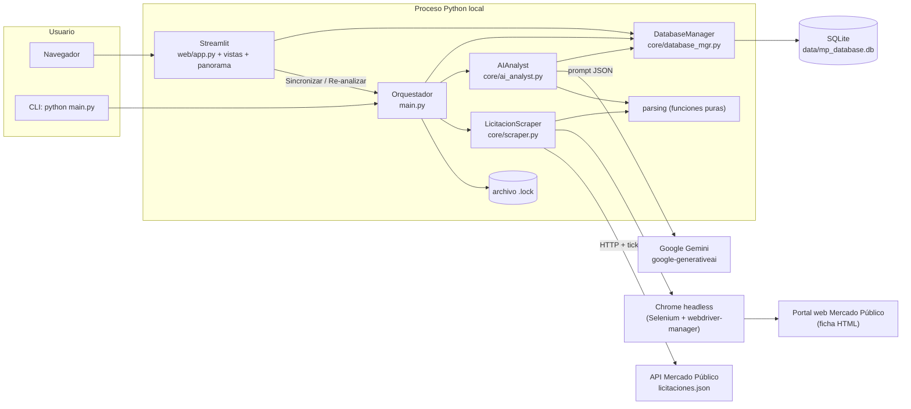
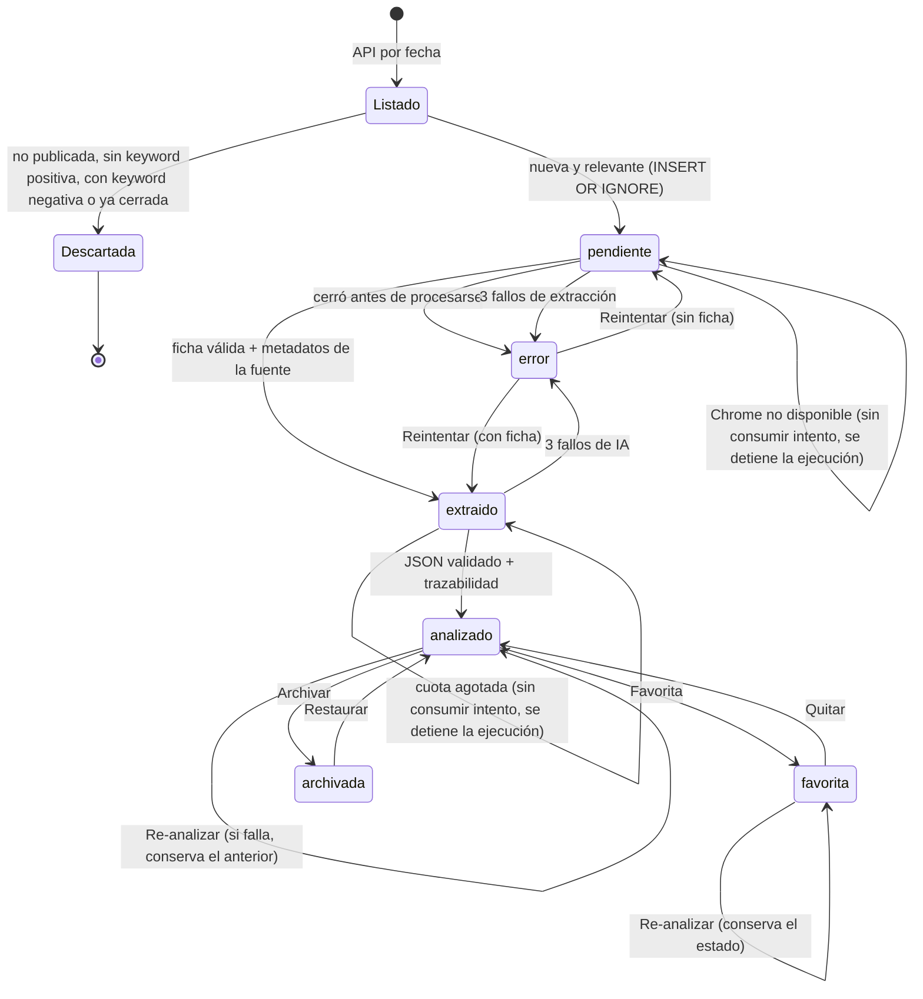
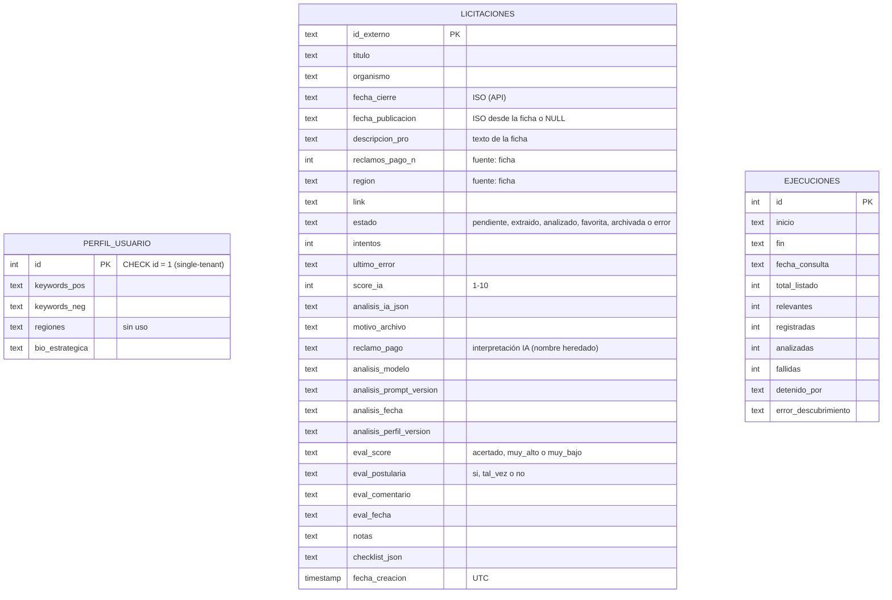
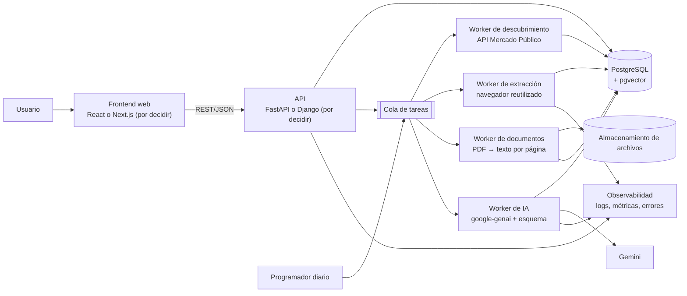

# LicitAI: dossier técnico del proyecto

> **Propósito.** Fuente de verdad para redactar el caso de estudio del portafolio, explicar decisiones de ingeniería y planificar una V2 Full Stack.
> **Estado documentado:** rama `mejoras-interfaz` (commit `4e2b5cc`), contenido idéntico al de `origin/main` tras el merge del PR #2 (`ad07a8b`), al **20/10/2026**. Incorpora las respuestas del autor a las preguntas abiertas (§22) y los pendientes registrados (§23).
> **Documento vivo:** las secciones marcadas con ⟳ (§4, §11, §20, §21) deben actualizarse a medida que se acumulen días de datos (ver §23.2).
> **Cómo leer las afirmaciones:**
> - **[Código]**: observado en el código fuente.
> - **[Test]**: cubierto por pruebas automatizadas que se ejecutaron (175/175 pasan).
> - **[Ejecución real]**: probado contra servicios reales durante la sesión del 20/10/2026.
> - **[Datos]**: consultado en las bases SQLite locales, en modo solo lectura.
> - **[Historial]**: tomado de git o de documentos versionados.
> - **[Inferencia]**: deducción razonable, no confirmada.
> - **[Propuesta]**: no existe en el sistema actual.

---

## 1. Resumen ejecutivo

LicitAI es un **prototipo de radar de licitaciones públicas chilenas** (Mercado Público) para una empresa proveedora. Funciona en cuatro pasos:
1. Descubre las licitaciones publicadas en el día mediante la API oficial.
2. Filtra las relevantes por palabras clave del perfil de negocio.
3. Extrae con Selenium el texto completo de cada ficha.
4. Pide a Google Gemini un análisis estructurado (score de 1 a 10, veredicto, puntos críticos y riesgos) que se **valida antes de guardarse**.

Los resultados se gestionan en un dashboard Streamlit (oportunidades, favoritas, archivo, cola en proceso, panorama analítico y perfil) **[Código]**.

Lo que distingue al prototipo no es la cantidad de funciones, sino el **rigor con que trata a la IA y a los datos**:
- Separa los datos verificables de la fuente (fecha, organismo y reclamos de pago, leídos de la ficha con expresiones regulares) de lo que infiere la IA.
- Guarda trazabilidad de cada análisis: modelo, versión del prompt y versión del perfil.
- Permite una evaluación humana para medir la calidad del score.
- Gestiona fallos con una cola de reintentos y un bloqueo contra ejecuciones simultáneas.

Hay 175 pruebas automatizadas deterministas **[Test]**.

**Lo que no es:**
- No es un producto en producción, no tiene usuarios externos y no está desplegado.
- Su precisión no está medida: hay **0 evaluaciones humanas** registradas a la fecha **[Datos]**.

---

## 2. Problema, usuario objetivo, contexto y propuesta de valor

| Aspecto | Descripción | Fuente |
|---|---|---|
| Problema | El portal publica más de mil licitaciones por día. Revisarlas a mano para encontrar las pocas pertinentes es lento, y las fichas son extensas (texto de 1,5 k a 125 k caracteres). | Volumen: `total_listado` observado (1.102 y 1.109 el 20/10/2026) **[Ejecución real]**; largo de fichas **[Datos]** |
| Usuario objetivo | Una empresa proveedora con un perfil de negocio único (single-tenant). El perfil almacenado corresponde a un proveedor de equipos y reactivos para laboratorios clínicos. | `perfil_usuario` **[Datos]**; BR-01 «Single-tenant» en `.GEMINI.md` **[Historial]** |
| Contexto | Mercado Público (ChileCompra): la API pública entrega listados por fecha con pocos campos; el detalle útil (criterios, requisitos, reclamos de pago) está en la ficha web. | Bitácora del 06/03/2026 («Gap de datos») **[Historial]**; `core/scraper.py` **[Código]** |
| Propuesta de valor | Reducir el listado diario a unas pocas oportunidades analizadas: score, riesgos, días al cierre y reclamos de pago del organismo. | **[Código]**. *No hay medición de ahorro de tiempo ni de precisión.* |

**Usuario real:** no lo hay. El perfil es **ficticio**. El autor eligió el rubro de laboratorio clínico porque observó que solía tener varias licitaciones publicadas, lo que permite reunir una muestra de análisis más amplia **[respuesta del autor]**. En el caso de estudio debe presentarse como un perfil de demostración, no como un cliente.

---

## 3. Alcance actual y funcionalidades implementadas

### 3.1 Descubrimiento y registro
- **Fuente:** API `licitaciones.json?fecha=DDMMAAAA&ticket=…`, con timeout de 30 s y errores HTTP, de red y de JSON diferenciados. El ticket no aparece en los mensajes de error. `LicitacionScraper.descubrir_licitaciones_del_dia` **[Código][Test]**
- **Filtro:** estado 5 (Publicada), keywords positivas y negativas sin distinguir mayúsculas ni tildes, sin términos vacíos, y descarte de las ya cerradas. `filtrar_licitaciones_relevantes`, `parsing.coincide_keywords` **[Código][Test]**
- **Registro:** se registran **todas** las licitaciones nuevas relevantes; el límite por ejecución solo aplica al procesamiento. `main._ejecutar` **[Test]**

### 3.2 Cola de procesamiento
- **Origen:** la cola se arma desde la BD (estados `pendiente` y `extraido`), así que retoma automáticamente lo que no se procesó antes. `DatabaseManager.obtener_cola_procesamiento` **[Test]**
- **Límite:** `LICITAI_MAX_PROCESAR` (5) **intentos** por ejecución.
- **Reintentos:** cada fallo suma un intento; con `LICITAI_MAX_INTENTOS` (3) intentos fallidos el registro pasa a `error`, visible en la página «En proceso» con el botón «Reintentar». **[Test]**
- **Paradas que no consumen intentos:** cuota de Gemini agotada y Chrome que no arranca. **[Test]**
- **Bloqueo** por archivo `<bd>.lock` contra ejecuciones simultáneas, con detección de bloqueos huérfanos después de 120 min. `main.bloqueo_pipeline` **[Test]**

### 3.3 Extracción
- **Navegación:** Selenium con Chrome headless navega a la ficha; espera a que el texto se estabilice y valida que realmente sea una ficha. `LicitacionScraper.extraer_detalle_licitacion`, `esperar_texto_estable`, `parsing.texto_ficha_valido` **[Código][Test parcial]**
- **Metadatos de la fuente:** título, organismo, fecha de publicación (ISO), fecha de cierre, número de reclamos por pago atrasado y región, extraídos con regex. `parsing.extraer_metadatos_ficha` **[Test]**. Contra datos reales, el patrón de reclamos y el de fecha de publicación aparecieron en 20 de 20 fichas guardadas **[Datos]**.

### 3.4 Análisis de IA
- Gemini en modo JSON con `temperature=0`; el texto de la ficha va truncado a 40 000 caracteres y delimitado como dato no confiable.
- La respuesta se valida antes de persistirse.
- Se guarda la trazabilidad: modelo, `PROMPT_VERSION` y versión del perfil.
- Detalle en §11. **[Código][Test][Ejecución real]**

### 3.5 Interfaz (Streamlit, navegación superior)
| Página | Qué ofrece |
|---|---|
| **Oportunidades** | KPIs, búsqueda y filtros (texto, score mínimo, región, orden, ocultar cerradas) y tarjetas con anillo de score, chips de cierre, región y reclamos, más un desplegable con el análisis y la evaluación humana. |
| **Favoritas** | Detalle ampliado y «Preparación»: checklist y notas persistidas en SQLite. |
| **Archivo** | Licitaciones descartadas, con opción de restaurarlas. |
| **En proceso** | Pendientes y errores, con mensajes en lenguaje de usuario y detalles técnicos plegados. |
| **Panorama** | 5 visualizaciones en Altair (embudo, próximos cierres, score vs. reclamos, distribución, calibración) y exportación JSON/CSV. |
| **Perfil** | Keywords y descripción de la empresa. Muestra el impacto de un cambio: re-analizar a pedido los análisis afectados (con confirmación) y descartar de la cola lo que ya no coincide. |

**Fuentes:** `web/app.py`, `web/vistas.py`, `web/panorama.py`, `web/estilos.py` **[Código]**. La UI tiene tests con `streamlit.testing.AppTest` **[Test]**, y en el navegador real se verificaron el guardado de notas y checklist y el re-análisis con Gemini **[Ejecución real]**.

### 3.6 Herramientas de mantenimiento
- `python -m core.migrar_datos`: corrige bases antiguas a partir de las fichas ya guardadas. Por defecto solo simula; con `--aplicar` crea un respaldo antes. **[Test]**
- `python main.py --fecha DDMMAAAA --max N`: ejecuta el pipeline por línea de comandos **[Código]**.
- Logging opcional a archivo con `LICITAI_LOG_FILE` **[Test]**.

---

## 4. Tabla de funcionalidades por nivel de verificación ⟳

| Funcionalidad | Estado | Evidencia |
|---|---|---|
| Descubrimiento por API + filtro de keywords, negativas y cierre | **Verificada** | `tests/test_pipeline.py`, `tests/test_parsing.py`; ejecución real (20/10/2026: 1.102 publicadas → 3 relevantes) |
| Registro completo y cola con límite por intentos | **Verificada** | `test_registra_todas_y_procesa_limite_luego_retoma`, `test_limite_cuenta_intentos_no_exitos` |
| Reintentos, estado `error` y «Reintentar» | **Verificada** | `test_fallos_repetidos_pasan_a_error_y_son_visibles`, `test_botones_de_estado_en_cada_pagina` |
| Extracción con Selenium (headless) | **Verificada (real) / parcial (tests)** | Ejecuciones reales del 20/10/2026 (fichas de 10–20 k caracteres). Los tests solo cubren el arranque fallido de Chrome y la espera de texto estable, no la navegación |
| Metadatos verificables desde la ficha | **Verificada** | `test_extraer_metadatos_ficha`; 20/20 fichas reales con reclamos y fecha **[Datos]** |
| Análisis Gemini con validación y trazabilidad | **Verificada** | `tests/test_ai.py` (31 tests); ejecuciones reales del 20/10/2026 (4 licitaciones distintas, 11 llamadas a Gemini en total, todas válidas) |
| Estabilidad del score con `temperature=0` | **Parcial (n=1)** | Una licitación: 8/8/8 en tres llamadas, frente a 7 y 9 con la temperatura por defecto. Muestra mínima |
| Bloqueo contra ejecuciones simultáneas | **Verificada** | `tests/test_infraestructura.py` |
| Favoritas, archivo, notas y checklist persistentes | **Verificada** | `test_notas_persisten` + verificación E2E en navegador |
| Evaluación humana del análisis | **Verificada (mecánica)** | `test_evaluacion_se_guarda`. **Sin datos reales: 0 evaluaciones** |
| Panorama: embudo, cierres, riesgo, histograma | **Verificada (render)** | `tests/test_panorama_exportar.py`. El embudo real está **vacío**: 0 ejecuciones registradas |
| Calibración score vs. evaluación humana | **Implementada, sin datos** | Se dibuja con ≥10 evaluaciones; hoy hay 0 |
| Versionado del perfil y re-análisis en lote | **Verificada** | `tests/test_perfil_version.py`; re-análisis real de 3 (scores sin cambio) |
| Exportación JSON/CSV | **Verificada** | `test_json_separa_procedencia_y_excluye_privados`, `test_csv_plano` |
| Migración de BD antiguas | **Verificada** | `tests/test_migracion.py`; simulación sobre la BD legacy real **[Datos]** |
| Ejecución programada (cron/Task Scheduler) | **No verificada** | El CLI existe; no se probó en un programador real |
| Despliegue (Streamlit Cloud u otro) | **No verificada** | No hay configuración de despliegue; el README lo declara |
| Comportamiento real ante cuota agotada de Gemini | **No verificada en real** | Solo simulado en tests |
| Ticket inválido o límite diario de la API de MP | **No verificada en real** | Solo simulado |
| Procesamiento de bases PDF, multiusuario, autenticación | **Planificada / propuesta** | §17–19 |

---

## 5. Stack tecnológico y justificación con evidencia

| Componente | Versión fijada | Rol | Justificación documentada |
|---|---|---|---|
| Python | 3.11 (venv); `numpy` del árbol de dependencias exige ≥3.11 | Lenguaje | No documentada; por eso el README exige 3.11+ |
| Streamlit | 1.54.0 | UI | No documentada. El prototipo usa Streamlit desde el commit inicial (`7583721`) **[Historial]** |
| SQLite | estándar | Persistencia | Single-tenant y local **[Inferencia]**. El plan de estabilización prohibía migrar a PostgreSQL en esa fase **[Historial: `licitai-plan-estabilizacion.md`]** |
| Selenium + webdriver-manager | 4.40.0 / 4.0.2 | Extracción de la ficha | La bitácora del 06/03/2026 constata que la API no entrega criterios ni requisitos, que sí están en la ficha web **[Historial]** |
| requests | 2.32.5 | Cliente de la API | — |
| google-generativeai | 0.8.6 | Cliente de Gemini | **SDK sin soporte de Google** (emite `FutureWarning`). Se decidió no migrarlo en el prototipo: según el autor, su vida útil es corta **[conversación del 20/10/2026]** |
| Altair | 6.0.0 | Gráficos | Ya venía instalado con Streamlit; se fijó porque ahora se importa directamente |
| pytest | ≥8.0 (dev) | Pruebas | — |
| Inter (WOFF2, OFL) | — | Tipografía | Incluida en `web/static/fonts/` para no depender de internet ni enviar datos a Google |

**Herramientas de desarrollo asistido por IA [respuesta del autor + Historial].** El desarrollo usó asistentes de IA de forma explícita y como objetivo de aprendizaje. Al principio fue Gemini CLI (hay rastros en `.GEMINI.md`, `.gemini/` y las bitácoras de «Gemini Prompts» en el historial) y después Claude Code, con el que se hicieron la auditoría, la estabilización y la mejora de la interfaz del 20/10/2026. El autor considera estos asistentes una herramienta relevante en la industria y busca aprender a usarlos desde sus proyectos personales. Sugerencia para el caso de estudio: presentarlo con transparencia, poniendo el acento en el criterio aplicado (auditoría previa, plan con aprobación, pruebas y verificación real) más que en la herramienta.

---

## 6. Arquitectura actual y responsabilidades

| Módulo | Responsabilidad | Funciones o clases clave |
|---|---|---|
| `core/config.py` | Variables de entorno, constantes de negocio (umbrales de score, límites) y logging | `ruta_db`, `configurar_logging`, `SCORE_MIN/MAX`, `UMBRAL_*` |
| `core/parsing.py` | Funciones puras: keywords, fechas, metadatos de la ficha, validación del JSON de la IA y versión del perfil | `coincide_keywords`, `extraer_metadatos_ficha`, `validar_analisis`, `version_perfil` |
| `core/database_mgr.py` | DAO SQLite: esquema, migración aditiva, cola, fallos, análisis, evaluación, ejecuciones y notas | `DatabaseManager`, `_migrar_esquema`, `registrar_fallo`, `reintentar` |
| `core/scraper.py` | API de Mercado Público, filtro y extracción con Selenium | `LicitacionScraper`, `DriverNoDisponible`, `esperar_texto_estable` |
| `core/ai_analyst.py` | Prompt, llamada a Gemini, validación y persistencia del análisis | `AIAnalyst`, `PROMPT_VERSION`, `AnalisisFallido`, `CuotaAgotada` |
| `core/exportar.py` | Exportación JSON/CSV independiente del esquema | `a_json`, `a_csv`, `registro_exportable` |
| `core/migrar_datos.py` | Corrección de BD antiguas a partir de las fichas guardadas | `calcular_cambios`, `migrar` |
| `main.py` | Orquestador: bloqueo, descubrimiento, cola, extracción, análisis, resumen y registro de la ejecución; re-análisis en lote | `ejecutar_pipeline`, `reanalizar_lote`, `describir_resumen`, `bloqueo_pipeline` |
| `web/app.py` | Punto de entrada: configuración de página, CSS, logo, navegación superior y pie | — |
| `web/paginas/*.py` | Un archivo por página (necesario para probarlas con `AppTest.switch_page`) | — |
| `web/vistas.py` | Presentación: helpers puros, HTML escapado, tarjetas, formularios, mensajes para el usuario y páginas | `html_tarjeta`, `mensaje_error_amigable`, `filtrar_y_ordenar`, `pagina_*` |
| `web/panorama.py` | Preparación de datos y gráficos Altair | `datos_embudo`, `datos_calendario`, `datos_calibracion`, `grafico_*` |
| `web/estilos.py` | CSS del tema oscuro (depende de los `data-testid` de Streamlit 1.54) | `css` |

---

## 7. Diagrama de arquitectura actual

---

## 8. Flujo de procesamiento de una licitación

Notas **[Código]**:
- El límite de 5 por ejecución cuenta **intentos**, no éxitos (`main._ejecutar`).
- Un `extraido` no vuelve a pasar por Selenium.
- Cuando la extracción tiene éxito, `actualizar_detalle_profundo` reinicia el contador de intentos.
- «Descartar de la cola» desde Perfil lleva los registros a `error` con un motivo (`vistas._impacto_perfil`).

---

## 9. Modelo de datos, persistencia y ciclo de vida

- **Sin claves foráneas:** el perfil es global y las ejecuciones son un registro agregado.
- **Migración de esquema aditiva e idempotente** (`_migrar_esquema`: `PRAGMA table_info` + `ALTER TABLE ADD COLUMN`). Nunca borra ni reescribe datos **[Test: `test_migracion_desde_esquema_antiguo_sin_perder_filas`]**.
- **Las actualizaciones no sobrescriben datos reales con marcadores** («Sin título», «No detectado», `None`) (`parsing.es_valor_util`) **[Test]**.
- **Las evaluaciones humanas se conservan si hay re-análisis.** La UI las marca como desactualizadas comparando `eval_fecha` con `analisis_fecha` **[Test]**.
- **Bases de datos presentes en el equipo [Datos]:**
  - `data/mp_database.db` (activa): 3 licitaciones analizadas, todas con trazabilidad completa; 0 evaluaciones; 0 ejecuciones registradas, porque la tabla se creó después de la primera sincronización.
  - `data/mp_database.legacy-20261020.db`: 21 registros del período del 05/02 al 30/09/2026, generados con la versión anterior y sus errores (fechas falsas, organismos `NULL`). Se archivó **sin migrar** por decisión del autor.
  - Las dos están ignoradas por git (`*.db`).

---

## 10. Integraciones externas y requisitos operativos

| Integración | Requisito | Fallos manejados | No verificado |
|---|---|---|---|
| API de Mercado Público | `MP_TICKET` en `.env` | Timeout, HTTP ≠ 200, JSON inválido, respuesta sin `Listado` (`descubrir_licitaciones_del_dia`) | Ticket inválido y límite diario reales |
| Portal web (Selenium) | Google Chrome instalado; red para `webdriver-manager` | Chrome no arranca, enlace no encontrado, ficha insuficiente, excepciones de navegación | Estabilidad de los selectores (`txtBuscar`, `btnBuscar`, `form-iframe`) en el tiempo; términos de uso del portal sobre automatización (§22) |
| Google Gemini | `GEMINI_API_KEY`; modelo `gemini-3-flash-preview` (configurable con `GEMINI_MODEL`) | Cuota (`ResourceExhausted`), red, respuesta bloqueada, vacía, truncada o inválida | Cuota agotada real; continuidad del SDK sin soporte |
| Google Fonts | Ninguno (fuente incluida en el proyecto) | — | — |

**Términos de uso del portal [respuesta del autor].** El autor revisó las condiciones a grandes rasgos y no identifica incumplimientos, porque el prototipo:
- no afecta la disponibilidad del servicio: hace una consulta por ficha, con pausas y un límite de 5 por ejecución;
- no reutiliza la información para otros fines;
- no evade medidas de seguridad.

*No es una revisión legal formal.* Para una V2 pública convendría una lectura detallada de los términos de la API y del portal.

**Otros requisitos operativos:**
- Ejecución local en Windows (`run_app.bat`) o en cualquier sistema con `python -m streamlit run web/app.py`.
- Variables opcionales documentadas en `.env.example`.
- La sincronización desde la UI es síncrona: ~26 s para 1 licitación y ~87 s para 3 en las corridas reales **[Ejecución real]**.

---

## 11. Diseño del análisis de IA ⟳

| Elemento | Detalle | Ubicación |
|---|---|---|
| Entradas | Perfil (bio, keywords positivas y negativas), código, título y organismo, y el texto de la ficha truncado a `IA_MAX_CHARS` (40 000) | `AIAnalyst.construir_prompt` |
| Defensa ante contenido no confiable | El texto va entre `<<<CORPUS>>>…<<<FIN_CORPUS>>>`, con la instrucción de ignorar órdenes dentro de él y de no inventar datos | ídem |
| Configuración | `response_mime_type="application/json"`, `temperature=0.0` | `AIAnalyst.__init__` **[Test]** |
| Salida esperada | `titulo_recuperado`, `organismo_recuperado`, `comportamiento_pago`, `score_ia`, `veredicto`, `puntos_criticos[]`, `riesgos[]`, `motivo_archivo` | prompt |
| Validación | `score_ia` entero (acepta "8"), dentro de [1, 10]; rechaza `bool`, decimales y textos como "8/10". `veredicto` es obligatorio. Las listas se normalizan (un texto suelto pasa a lista). Tolera bloques Markdown | `parsing.parsear_respuesta_ia`, `validar_analisis` **[Test: 31 en `test_ai.py`]** |
| Persistencia | Solo si la validación pasa. La IA rellena huecos de título u organismo, pero **nunca** sobrescribe datos de la fuente | `guardar_analisis_ia`, `reparar_datos_licitacion` |
| Umbrales | Escala 1–10; ≥7 alto, ≥4 medio; se pide `motivo_archivo` si el score es <5 | `core/config.py` |
| Trazabilidad | Modelo, `PROMPT_VERSION` (`2026-10-20.1`), versión del perfil (hash de 8 caracteres) y fecha | `guardar_analisis_ia` |
| Medición de calidad | Evaluación humana (¿el score es acertado?, ¿postularías?) y gráfico de calibración con ≥10 evaluaciones | `web/panorama.py` |

**Limitaciones confirmadas:**
1. **El prompt no define una rúbrica del score.** Pide un «entero del 1 al 10 según idoneidad» sin explicar qué significa cada valor **[Código]**.
2. **El score se concentra en valores altos.** En la BD legacy (prompt anterior, sin rúbrica), 18 de 20 scores están entre 7 y 9, y 11 son 9 **[Datos]**. Indica baja discriminación, pero la muestra es pequeña y de una versión anterior; no hay medición formal.
3. **Precisión no medida:** 0 evaluaciones humanas.
4. **El análisis solo usa el texto visible de la ficha.** No lee las bases en PDF, que es donde están multas, garantías y criterios detallados **[Código]**.
5. **La interpretación de pagos de la IA no está verificada.** La UI la muestra etiquetada como tal, junto al dato de la fuente.

---

## 12. Decisiones técnicas y trade-offs confirmados

Solo se listan las decisiones respaldadas por un documento, un commit o la conversación de trabajo del 20/10/2026.

| Decisión | Alternativa considerada | Motivo con evidencia |
|---|---|---|
| Embudo API → ficha web (Selenium) → IA | Usar solo la API | La API no trae criterios ni requisitos; Selenium es lento y frágil para uso masivo, así que se reserva para los candidatos ya filtrados **[Historial: bitácora 06/03/2026]** |
| Metadatos con regex sobre la ficha en vez de la IA | Que la IA los infiriera (versión anterior) | La versión anterior guardaba fechas de procesamiento como fecha de publicación y organismos `NULL` por claves mal escritas de la IA **[Historial: commit `ac3721c`; plan de estabilización]** |
| Cola en la BD con límite por intentos | Procesar solo lo descubierto en el día | Las pendientes nunca se retomaban (caso `494-1-LR26`) **[Historial: `594b794`]** |
| `temperature=0` | Temperatura por defecto | Score inestable observado (7 frente a 9 en la misma ficha) **[Historial: `6904e4f`]** |
| Mantener `google-generativeai` (sin soporte) | Migrar a `google-genai` | Decisión del autor: el prototipo tendrá una vida corta antes de la V2 |
| Recopilar con una BD nueva y archivar la antigua | Migrar los datos antiguos | Decisión del autor: los análisis antiguos tenían otro prompt y sin validación, y mezclarlos sesgaría la muestra para la demo |
| Navegación superior y tema oscuro único | Barra lateral, tema claro u oscuro | Elección estética del autor (dirección «Premium oscuro», referencia Linear) |
| Mantener la palabra «Score» | «Afinidad» | Elección del autor |
| Radio con CSS en vez de `st.segmented_control` | `segmented_control` | `AppTest` (Streamlit 1.54) no soporta `segmented_control` de selección única; se priorizó mantener la cobertura de tests **[Código: `web/estilos.py`]** |
| Anillo de score con `conic-gradient` | SVG | El sanitizador de `st.html` eliminó el SVG (observado en el render) |
| Re-análisis tras un cambio de perfil a pedido, con confirmación | Automático | Costo en llamadas a Gemini (decisión de diseño documentada en el commit `fa1a011`) |

---

## 13. Bugs, deuda técnica, riesgos y limitaciones (priorizados)

| Prioridad | Hallazgo | Impacto | Evidencia |
|---|---|---|---|
| Alta | **El score carece de rúbrica** y tiende a valores altos | Un score poco discriminante resta valor al filtro y a la demo | §11 **[Código][Datos]** |
| Alta | **Precisión no medida** (0 evaluaciones) | No se pueden hacer afirmaciones de calidad | **[Datos]** |
| Alta | **SDK `google-generativeai` sin soporte** | Puede dejar de funcionar sin aviso y cortar la recopilación | `FutureWarning` en cada import |
| Media | **Dependencia del DOM del portal** (IDs fijos, iframes) | Un cambio en el portal rompe la extracción; los registros quedarían en reintento o `error` | `core/scraper.py` |
| Media | **Sincronización síncrona en la petición de Streamlit** | La página queda ocupada varios minutos. Durante el re-análisis en lote la barra de progreso hace llamadas a Streamlit, así que una interacción podría cortar el lote (lo hecho se conserva) | `vistas.cabecera`, `vistas._impacto_perfil` |
| Media | **Un navegador Chrome nuevo por licitación** y descarga de driver con `webdriver-manager` | Lentitud (≈11 s medidos para extraer una ficha) y dependencia de red | `extraer_detalle_licitacion` **[Ejecución real, n=1]** |
| Media | **Solo una fecha por ejecución**; los días sin sincronizar se pierden (salvo `--fecha`) | Cobertura incompleta del listado | `descubrir_licitaciones_del_dia` |
| Media | **Filtro por subcadena del título** (sin límites de palabra ni sinónimos) | Falsos positivos («red» coincide con «redes») y falsos negativos | `coincide_keywords` |
| Alta | **Score sin rúbrica: pendiente registrado** (ver §23.1) | — | — |
| ~~Media~~ Resuelto | ~~README desactualizado tras el rediseño~~: actualizado el 20/10/2026 junto con este dossier (páginas, «En proceso», Perfil, versionado del perfil, estado y próximos pasos) | — | `README.md` |
| Baja | **Zona horaria mixta**: `fecha_creacion` en UTC y el resto en hora local | El embudo y el filtro de periodo pueden desplazar un registro de día (máx. ~3 h) | `datos_embudo`, `en_periodo` |
| Baja | **Semántica aproximada del embudo**: suma los listados por fecha consultada; una misma licitación podría aparecer en listados de días distintos **[Inferencia]** | El porcentaje «publicadas → relevantes» es indicativo | `datos_embudo` |
| Baja | **Nombre heredado `reclamo_pago`** (guarda la interpretación de la IA) junto a `reclamos_pago_n` (dato de la fuente) | Confusión en el esquema | `database_mgr.py` |
| Baja | **Columna `perfil_usuario.regiones` sin uso** | Deuda del esquema | ídem |
| Baja | **Un bloqueo de más de 120 min se considera huérfano** | Una ejecución anormalmente larga podría solaparse con otra | `bloqueo_pipeline` |
| Baja | **User-Agent fijo («Chrome/119»)**, distinto del Chrome real | Posible inconsistencia de huella | `_crear_driver` |
| Baja | **El JSON y el CSV de exportación se generan en cada render de Panorama** | Costo innecesario con muchas fichas (sobre todo si se incluye el texto) | `vistas._exportar` |
| Baja | **El CSS depende de los `data-testid` internos de Streamlit 1.54** | Una actualización de Streamlit puede romper estilos | `web/estilos.py` |
| Baja | **Las URL inexistentes muestran «Page not found» en inglés** (Streamlit) | Detalle de pulido | Observado en el render |
| Info | **El historial de git contiene snapshots de BD** (`data/mp_database.db`, `research/data/mp_database.db`) **y una `SECRET_KEY` de desarrollo de Django** en la rama remota `evolucion-django`. **El repositorio es público** | Las BD se subieron **a propósito**, para que quien clonara el repo tuviera datos que ver en la interfaz; según el autor no contienen información sensible (son datos públicos de licitaciones y un perfil ficticio). La `SECRET_KEY` se versionó por desconocimiento: era el primer uso de Django. No se usa en nada desplegado y no hay otras credenciales (revisado) | `git log --all` **[Historial]**, respuesta del autor. Para una V2: secretos solo por entorno desde el inicio |

---

## 14. Pruebas y nivel real de verificación

**Suite:** 175 pruebas con pytest, deterministas. Usan BD temporales y simulan la API, Selenium y Gemini. `pytest.ini` excluye por defecto el marcador `externo`. La última corrida, el 20/10/2026, pasó 175 de 175 en ~10 s.

| Archivo | Tests | Qué cubre |
|---|---|---|
| `test_ui.py` | 42 | Helpers de presentación, escapado HTML, mensajes para el usuario y todas las páginas con `AppTest` (botones, notas, evaluación, perfil, re-análisis con y sin éxito) |
| `test_ai.py` | 31 | Validación del JSON, respuestas inválidas, cuota, re-análisis fallido, prompt (truncado y delimitadores) |
| `test_parsing.py` | 24 | Keywords, fechas, metadatos de la ficha, validez de la ficha |
| `test_panorama_exportar.py` | 21 | Datos de cada gráfico, construcción Vega-Lite, exportación, trazabilidad, registro de ejecuciones |
| `test_pipeline.py` | 19 | Cola, límites, reintentos, filtros, errores HTTP, Chrome caído |
| `test_database.py` | 14 | Esquema, migración, CRUD, ciclo de fallos y reintento, notas |
| `test_perfil_version.py` | 12 | Versión del perfil, afectados, re-análisis en lote, página Perfil |
| `test_infraestructura.py` | 9 | Bloqueo, logging, espera de Selenium, configuración de Gemini |
| `test_migracion.py` | 3 | Simulación sin escritura, respaldo y aplicación idempotente |

**Verificaciones manuales o externas del 20/10/2026** (no automatizadas; los scripts quedaron fuera del repositorio):
- Instalación limpia con `requirements-dev.txt` en un venv nuevo, y `streamlit run` desde otro directorio.
- Pipeline real: API, Selenium y Gemini, con 1 y con 3 licitaciones.
- Navegador real (Selenium sobre la app): guardado y recarga de notas y checklist, y re-análisis con Gemini.
- Capturas visuales de todas las páginas en ambos estados de datos.

**Brechas de verificación:**
- No hay CI.
- No hay tests de la navegación real de Selenium.
- No hay pruebas de carga.
- La UI no se probó en móvil ni en otros navegadores.

---

## 15. Aprendizajes técnicos

**Hechos observados en el proyecto:**
- Un dato inferido por la IA (organismo, fecha) puede llegar vacío o mal nombrado. Extraer lo verificable de la fuente y dejar a la IA solo el juicio redujo errores de datos (5 de 20 fechas falsas y 2 organismos `NULL` detectados en la auditoría) **[Historial]**.
- Validar la salida del LLM antes de persistirla evita que un JSON malformado rompa la UI (por ejemplo, un score `None` comparado con `>= 7`) **[Historial: `594b794`]**.
- Un límite que cuenta «éxitos» en vez de «intentos» puede convertir una caída del portal en un bucle largo **[Historial]**.
- Con `temperature` por defecto, la misma ficha dio scores distintos; con 0 se repitió el valor (n=1) **[Ejecución real]**.
- Las herramientas de test de un framework pueden no cubrir todos sus widgets (`segmented_control` en `AppTest`) y condicionar decisiones de UI **[Código]**.

**Recomendaciones (no implementadas):**
- Definir una rúbrica del score y medirla contra las evaluaciones humanas antes de publicar cualquier cifra de calidad.
- Versionar también el formato de salida del modelo, con un esquema JSON formal.

---

## 16. Evolución histórica relevante

| Fecha | Hito | Evidencia |
|---|---|---|
| 07/02/2026 | Commit inicial «MVP sistema completo»: Streamlit, SQLite, Selenium y Gemini, con la BD versionada | `7583721` |
| 12/02/2026 | Estructura y script `.bat` | `5c40997` |
| 28/02–02/03/2026 | **Intento de V2**: Django 5 + DRF + PostgreSQL (Supabase) + cifrado Fernet; ERD con `Tender`, `Analysis`, `Attachment`, etc.; roadmap con Celery/Redis y React | `78cc996`, `.GEMINI.md`, `Gemini Prompts/roadmap.md`, bitácora 28/02 |
| 02/03/2026 | La V2 se fusiona en `main` (PR #1) y se **revierte** minutos después (PR #2), restaurando el prototipo. **Motivo (autor):** de orden práctico. Al iniciar la mejora coincidieron la práctica universitaria y el proyecto de título, así que se decidió mantener en `main` la versión relativamente completa (el prototipo) hasta poder retomar y redefinir la V2 | `f8484a8`, `a164246`, `963a109`; respuesta del autor |
| 02–11/03/2026 | La rama `evolucion-django` sigue: cliente de la API con reintentos, `DiscoveryService`, normalización de tildes y la idea del «embudo de 3 capas» | `cdd309e`, `1569731`, bitácora 06/03 |
| 30/09/2026 | Ajustes y verificación del prototipo; se quita la BD del índice de git | `4bc075a` |
| 20/10/2026 | Plan y auditoría de estabilización → PR #1 `estabilizacion` (6 commits) | `9b1a355`…`6904e4f`, `ed92af2` |
| 20/10/2026 | PR #2 `mejoras-interfaz`: panorama, evaluación, trazabilidad, versionado del perfil, rediseño oscuro y textos para el usuario | `3dc1e62`…`4e2b5cc`, `ad07a8b` |

La numeración de los PR se repite: hay un #1 y un #2 en marzo y otros en octubre. Eso sugiere que el repositorio remoto se recreó (hoy es `randradev/licitai-prototipo`) **[Inferencia, ver §22]**.

---

## 17. Propuesta de evolución hacia una V2 Full Stack [Propuesta]

> Nada de esta sección existe hoy.

**Objetivos:**
- Pasar de un script con UI a un **producto con API, workers y frontend**.
- Analizar las **bases en PDF con citas por página**.
- **Medir la IA** de forma sistemática.

| Capa | Propuesta | Motivo |
|---|---|---|
| Frontend + API | **Stack no decidido.** Opciones que baraja el autor: **FastAPI + React** (ya los ha usado) o **Django + Next.js** (oportunidad de aprender frameworks nuevos). No debe presentarse como una decisión cerrada | Experiencia web real; demo pública; separar la lógica de la UI con contratos tipados |
| Datos | PostgreSQL (+ pgvector para fragmentos de PDF); migraciones con Alembic o Django | Concurrencia, multiusuario e integridad referencial |
| Trabajos | Cola de tareas (Celery/RQ/Arq) con reintentos y backoff; programador diario | Quitar el procesamiento de la petición web |
| Extracción | Un navegador por worker (Playwright o Selenium) reutilizado; caché de fichas | Rendimiento y resiliencia |
| IA | SDK `google-genai` con esquema de salida estructurado, rúbrica explícita del score, prompts versionados en BD | Continuidad y calidad medible |
| Seguridad | Autenticación, secretos en un gestor, cifrado del ticket (idea ya presente en marzo) | Multiusuario |
| Observabilidad | Logs estructurados, métricas por etapa, trazas y seguimiento de errores | Operación |

Reutilizable del prototipo, porque es lógica pura y está testeada:
- `core/parsing.py`, la validación y la exportación.
- El modelo de estados de la cola.
- La trazabilidad y la evaluación humana.

---

## 18. Diagrama de arquitectura objetivo [Propuesta]

---

## 19. Mejoras potenciales [Propuesta]

| Área | Mejora | Notas |
|---|---|---|
| Bases PDF con citas | Descargar los adjuntos, extraer el texto **por página**, dividirlo en fragmentos con metadatos (documento, página), recuperar los pertinentes y exigir que el modelo cite `documento:página` en cada riesgo o requisito. Validar que cada cita exista | Ya estaba planteado como RF-11/RF-12 en `.GEMINI.md` |
| Tareas asíncronas | Workers y cola; progreso visible por etapa | Elimina el bloqueo de la UI |
| Recuperación de errores | Backoff exponencial, clasificación de errores (transitorios/permanentes), una «cola muerta» con causa | El prototipo ya distingue cuota, driver y fallo individual |
| Evaluación de IA | Rúbrica del score; set de evaluación con las evaluaciones humanas; métricas de acuerdo por tramo; comparación entre versiones de prompt (ya hay `PROMPT_VERSION` y la versión del perfil) | La base de datos para esto ya se está capturando |
| Seguridad | Autenticación, roles, secretos gestionados, limpieza del historial si el repo es público | §13 |
| Despliegue | Contenedores, CI con tests, entorno de demo de solo lectura con datos precargados (vía `core/exportar.py`) | La exportación JSON ya separa fuente, IA y evaluación |
| Observabilidad | Tabla `ejecuciones` → métricas; alertas por fallos repetidos del portal | La tabla ya existe |

---

## 20. Evidencias útiles para el portafolio ⟳

**Código representativo:**
- **Validación del LLM:** `core/parsing.py` → `validar_analisis`, `parsear_respuesta_ia`.
- **Defensa ante prompt injection y versionado:** `core/ai_analyst.py` → `construir_prompt`, `PROMPT_VERSION`.
- **Datos verificables de la fuente:** `core/parsing.py` → `extraer_metadatos_ficha`.
- **Cola resiliente:** `core/database_mgr.py` → `registrar_fallo`, `reintentar`, `obtener_cola_procesamiento`; `main.py` → `_ejecutar`, `bloqueo_pipeline`.
- **Versionado del perfil:** `core/parsing.py` → `version_perfil`; `web/vistas.py` → `afectados_por_perfil`; `main.py` → `reanalizar_lote`.
- **Mensajes para el usuario final:** `web/vistas.py` → `mensaje_error_amigable`, `mensaje_sincronizacion`.
- **Visualización con criterio:** `web/panorama.py`. La paleta está validada con un script de contraste y daltonismo, y cada gráfico tiene vista de tabla.

**Pruebas destacables:**
- `test_registra_todas_y_procesa_limite_luego_retoma`
- `test_respuestas_invalidas_no_persisten`
- `test_reanalisis_fallido_conserva_anterior`
- `test_tarjeta_html_escapa_texto_externo`
- `test_pipeline_bloqueado_no_registra_ejecucion`

**Ejemplos reales** (datos públicos de Mercado Público, 20/10/2026):
- Listado de 1.109 licitaciones → 3 coincidieron con el perfil → 3 analizadas.
- Ejemplo de ficha: `1057544-350-LP26`, cierre el 09/11/2026, 80 reclamos de pago según la ficha, score 8.

**Capturas:** las que se tomaron durante el desarrollo están en la carpeta temporal de la sesión, **no en el repositorio**, y se perderán. Hay que **generar capturas nuevas** con datos reales acumulados antes de publicar (ver §22).

---

## 21. Límites de las afirmaciones públicas ⟳

| Se puede afirmar (demostrado) | No se puede afirmar (sin evidencia) |
|---|---|
| Pipeline de punta a punta funcional contra los servicios reales (ejecutado el 20/10/2026) | Ahorro de tiempo, número de usuarios, licitaciones ganadas o retorno de inversión |
| Salida de la IA validada; trazabilidad de modelo, prompt y perfil | Precisión o calidad del score (0 evaluaciones) |
| Separación entre los datos de la fuente y la inferencia de la IA | Que funcione en producción o a escala |
| 175 pruebas automatizadas que pasan | Que esté desplegado o sea accesible públicamente |
| Recuperación ante fallos (reintentos, estado `error`, bloqueo) | Robustez a largo plazo frente a cambios del portal |
| Score estable con `temperature=0` en la prueba realizada (n=1) | Estabilidad del score en general |
| Embudo diario observado (1.1 k → 3) en un día | Tasas de filtrado representativas (un solo día de datos) |

**Criterio para publicar cifras de calidad del score** (acordado el 20/10/2026, ver §23.2): 10 evaluaciones son solo un checkpoint interno. Para publicar, se necesitan ≥30–50 evaluaciones con ≥8–10 por tramo mostrado, presentadas como «muestra preliminar, n = X», junto con la distribución de scores (por el sesgo del filtro hacia buenos calces). Si el score se sigue concentrando en 7–9, eso mismo es un hallazgo publicable y motiva la rúbrica (§23.1).

---

## 22. Preguntas al autor: respuestas y preguntas abiertas

### 22.1 Respondidas (20/10/2026)
| # | Pregunta | Respuesta del autor | Dónde se incorporó |
|---|---|---|---|
| 1 | ¿El perfil corresponde a una empresa real? | No, es **ficticio**. El rubro (laboratorio clínico) se eligió porque suele tener varias ofertas y permite una mejor muestra | §2 |
| 2 | ¿Por qué se revirtió el intento con Django? | Por razones prácticas: coincidió con la práctica universitaria y el proyecto de título, así que se mantuvo en `main` la versión relativamente completa hasta retomarlo | §16 |
| 3 | ¿El repositorio es público? | Sí. Las BD se subieron a propósito, para que quien clonara tuviera datos que visualizar, y no contienen información sensible. La `SECRET_KEY` de Django se versionó por desconocimiento (primer uso del framework) | §13 |
| 4 | ¿Cómo presentar el uso de asistentes de IA? | Como una herramienta relevante en la industria que el autor aprende a usar desde sus proyectos personales; primero probó Gemini CLI y luego Claude Code | §5 |
| 5 | ¿Términos de uso del portal? | Revisados a grandes rasgos; no identifica incumplimientos (no afecta la disponibilidad, no reutiliza la información para otros fines, no evade medidas de seguridad) | §10 |
| 6 | ¿Stack de la V2? | **No decidido.** Opciones: FastAPI + React (conocidas) o Django + Next.js (aprender algo nuevo). No presentarlo como decisión cerrada | §17, §18 |
| 7 | ¿Cuántas evaluaciones antes de publicar cifras? | Empezar con unas 10 e ir actualizando con más datos. Criterio acordado en §23.2: 10 como checkpoint interno; para publicar, ≥30–50 evaluaciones con ≥8–10 por tramo mostrado, y siempre con «n = X» | §21, §23.2 |

### 22.2 Abiertas
1. **Tiempo invertido y rol:** ¿quieres incluir la duración del proyecto o el esfuerzo? No se puede deducir con fiabilidad del historial: hay pausas largas entre marzo y septiembre de 2026.
2. **Base legacy** (21 análisis de feb–sep 2026): ¿se usará en el caso de estudio como «antes» (con sus errores documentados) o se descarta?
3. **Rúbrica del score:** ¿qué criterios de idoneidad importan para el perfil (rubro, monto, plazo, región, requisitos de experiencia, riesgo de pago)? Es necesario para §23.1.
4. **Numeración de los PR repetida:** ¿el repo actual es una recreación del original? Solo es relevante para contar la historia.

---

## 23. Pendientes registrados

### 23.1 Rúbrica de idoneidad del score: pendiente, prioridad alta
**Problema.** El prompt pide «un entero del 1 al 10 según idoneidad» sin definir qué significa cada valor (`core/ai_analyst.py` → `construir_prompt`). Sin una rúbrica, el score es difícil de interpretar y de comparar entre ejecuciones, y los datos antiguos sugieren que se concentra en 7–9 (§11).

**Qué debería incluir** [Propuesta, sin implementar]:
- **Criterios explícitos con su peso**, por ejemplo: calce del rubro y de los productos, requisitos excluyentes (certificaciones, experiencia), plazo de entrega, monto, riesgo de pago y región.
- **Anclas por tramo:**
  - 1–3: no corresponde al rubro o hay un excluyente;
  - 4–6: calce parcial o riesgos relevantes;
  - 7–8: buen calce con riesgos manejables;
  - 9–10: calce casi total sin excluyentes.
- **Justificación breve por criterio** en la salida JSON, para que el score sea auditable.

**Al implementarla:**
- Subir `PROMPT_VERSION`.
- Mantener la validación (`validar_analisis`) y agregar los campos nuevos si los hay.
- Comparar la distribución de scores antes y después.
- Usar «Actualizar análisis» para re-analizar a pedido si se quiere homogeneizar la muestra.

**Dependencia:** la definición de los criterios depende del autor (§22.2, pregunta 3).

### 23.2 Recopilación diaria de datos y actualización del dossier: en curso
**Qué hacer:** ejecutar la sincronización **una vez al día**, desde la app («Sincronizar ahora») o con `python main.py`, y **evaluar los análisis** desde «Análisis y evaluación». La primera sincronización registrada en la tabla `ejecuciones` será la próxima; hoy hay 0.

**Puntos de control:**
| Hito | Condición | Qué se habilita |
|---|---|---|
| Checkpoint interno | ~10 evaluaciones | Se dibuja la calibración; revisión cualitativa (¿hay scores bajos?, ¿coinciden con tu juicio?) |
| Evidencia preliminar publicable | ≥30–50 evaluaciones, ≥8–10 por tramo mostrado | Cifras de acuerdo IA–humano, siempre como «muestra preliminar, n = X» |
| Embudo representativo | Varias semanas de ejecuciones | Tasas de filtrado (publicadas → relevantes) con rango de fechas |

**Advertencia de sesgo:** el filtro de keywords deja pasar sobre todo licitaciones con buen calce, así que habrá pocos scores bajos para evaluar. Hay que reportar la distribución junto con cualquier cifra.

**Qué actualizar en este dossier en cada checkpoint (secciones ⟳):**
- §4: estado «Evaluación humana» y «Calibración», ya con datos.
- §11: distribución real del score con la versión de prompt vigente.
- §20: ejemplos reales nuevos y capturas regeneradas con datos acumulados.
- §21: qué se puede afirmar con el n alcanzado.
- En cada actualización, anotar la fecha, el rango de datos (primera y última `fecha_creacion`), el n de evaluaciones y la `PROMPT_VERSION`.

**Registro de actualizaciones:**
| Fecha | Ejecuciones | Licitaciones analizadas | Evaluaciones | `PROMPT_VERSION` | Notas |
|---|---|---|---|---|---|
| 20/10/2026 | 0 registradas (1 sincronización previa a la tabla) | 3 | 0 | 2026-10-20.1 | Línea base; base legacy archivada sin migrar |
